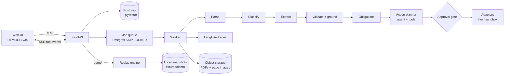

# Paperbound: Architecture

> Drop in any PDF. Paperbound tells you what it says, what you owe, and by when, then sets it up so nothing slips.

This doc is the source of truth. Update it before changing behavior.

---

## 1. Goals and non-goals

**Goals**
- Turn any messy PDF (scanned, native, mixed) into structured fields with provenance (page + bounding box).
- Detect obligations (deadlines, renewals, expirations, payments) and propose actions.
- Use deterministic code wherever it works; use LLMs only where rules cannot decide.
- Make every decision traceable and every quality claim measurable (eval harness).
- Ship one public app where anyone can upload a PDF or try a sample that needs no upload and costs nothing per click.

**Non-goals (v1)**
- Multi-tenant auth, billing, teams.
- Sending email directly (drafts only).
- Fine-tuning models.

---

## 2. Run modes

One public app, no deploy modes and no access code. A visitor either uploads their own PDF or tries a sample.

| Run | Trigger | Pipeline | Actions | LLM cost |
|---|---|---|---|---|
| `live` | **Upload** (button or drag and drop) | Real, end to end, in a background worker | Approval gate, then sandbox adapters on the server | Yes, within the daily budget |
| `sample` | **Try a sample** (Lease, Insurance certificate) | Replays a recorded real run from a local snapshot, with narration | Sandbox adapters only (in the browser) | Zero, and no database calls |

Uploads are on whenever `DATABASE_URL` and `OPENAI_API_KEY` are both set. If either is missing the page shows samples only, with a short note saying why. Samples always work, even with a paused database or an exhausted budget.

Both kinds of run stream **the same events** (`meta`, `step` with narration, `field`, `obligations`, `brief`, `action`, `done`), so the page has one renderer. The only differences are where the events come from (`/demo/<fixture>/events` or `/runs/<id>/events`) and where approvals go (browser sandbox or server).

**Sample (demo) design**
- Samples **never touch Supabase or OpenAI**. It reads a local snapshot committed to the repo, so it works even when the database is paused or the API key is out of credit.
- Snapshots are **real recorded runs**, not hand-made data. `scripts/record_demo.py` runs the live pipeline once on a curated sample PDF and exports the full run to `fixtures/demo/<fixture>/`:

```
fixtures/demo/lease/
  source.pdf
  pages/1.png, 2.png, ...        rendered page images
  snapshot.json                  document, pages (words + bboxes), steps, fields, obligations, proposed actions
  narration.json                 explanatory comment per step (hand-editable)
```

- **Replay engine** (`paperbound/demo/replay.py`) loads the snapshot and streams step events over the same SSE endpoint shape as live runs, using each step's original relative timing (capped at 1.5s per step). The frontend cannot tell the difference except for the badge.
- **Narration for a live feel**: each step event carries a `narration` string that explains what is happening and why, shown in the timeline as it streams. Examples:
  - parse: "Page 3 has no usable text layer, so it would be routed to OCR."
  - validate: "11 of 12 fields were found word-for-word on the page. The rent amount was not, so its confidence drops."
  - obligations: "The lease ends 2027-03-31 with 90 days' notice, so notice is due by 2026-12-31."
  - gate: "Calendar events are reversible, so this one only needs a single approval."
  `record_demo.py` drafts narration from each step's `reason` field; it is then edited by hand and committed.
- **Progressive reveal**: fields appear one at a time as the extract step streams, and bbox highlights animate in, so the run feels live.
- The UI shows a badge: `Sample run · recorded <date> · as of <AS_OF>`. This keeps it honest when an interviewer asks "is this real?" A live run's badge reads `Your document · live run · as of <date>`.
- **Approvals in a sample** run against sandbox adapters implemented **in the browser** (Sandbox Calendar, Sandbox Inbox, Webhook log panels). Nothing is sent to the server or persisted; refreshing the page resets the demo.

**Implementation status (demo mode)**
- `scripts/record_demo.py` runs the live pipeline (no database) as of `AS_OF` (default 2026-10-22) on `lease.pdf` and `insurance_certificate.pdf` and writes `fixtures/demo/lease/` and `fixtures/demo/insurance_certificate/`: `source.pdf`, `pages/<n>.png`, `snapshot.json` (document and classification, pages with words and boxes, steps with timings, fields with boxes, obligations, brief, proposed actions with groups, totals, `recorded_at`, `as_of`, `model`) and `narration.json` (`intro`, `steps` by stage plus `gate`, `actions` by group key or `tool:<name>`, `outro`). Narration is drafted from the recorded data and then edited by hand; re-recording never overwrites an existing `narration.json` unless `--redraft`. Links inside recorded reminders are written as `/#demo=<fixture>&page=<n>`.
- `paperbound/demo/replay.py` builds the whole replay as a list of (wait, event, data) and streams it as SSE. Events: `meta` (badge, narration intro), `step` (a `running` event, then the finished one with narration), `field` (phase `extracted` while the extract step streams, then phase `validated` with confidence, flags and boxes while validate streams), `obligations`, `brief`, `action` (one per proposal), a synthesized `gate` step, and `done`. Each step is replayed in its recorded duration capped at 1.5 s, with a 0.3 s floor so a step that took no time stays readable (`?speed=0` sends everything at once, used by tests). The module imports no database, no OpenAI and no pipeline code; a test imports it in a clean process and asserts that.
- The page cannot tell a replay from a live run except for the badge: it reuses the same renderers.

**Implementation status (public uploads)**
- `POST /documents` saves the file, creates a `queued` run and a job, writes the first `meta` event and returns at once. `paperbound/jobs.py` holds the queue, the worker and the event writer: one worker task, started in the FastAPI lifespan, claims the oldest queued job with `SELECT ... FOR UPDATE SKIP LOCKED` and runs the pipeline in a thread. `run_pipeline` takes an `observer` that is told when each stage starts and ends; the worker turns those into stored rows (steps, fields, obligations, actions) and `run_events` rows.
- Narration for live runs comes from `paperbound/narration.py`, the same templates `scripts/record_demo.py` uses to draft `narration.json`. It is code, not an LLM.
- `GET /runs/{id}/events` replays stored events from the database and then follows new ones (polling every 0.4 s, a heartbeat every 15 s). Each frame has an `id:` (its sequence number), so a reconnecting `EventSource` sends `Last-Event-ID` and receives only what it missed; `?after=<seq>` does the same. Replayed `action` events are refreshed with the action's current status, so a reopened run shows what was already approved. The stream ends after `done`, or when the run is finished and has nothing left to send.
- A job interrupted by a restart is ended at the next start: its run becomes `failed` and its stream receives a final `done`.
- Live `meta` arrives twice: at upload (document id, page count, no type yet) and again after classification (type and classification). The renderer merges them.

---

## 3. System overview



**Process layout**
- **One queue, many possible workers.** Any process that can reach the database and has uploads enabled starts a worker and claims jobs from the shared `jobs` table, with whatever code it was started with. A local server pointed at the production database therefore runs production uploads with local (possibly stale) code, and its page files stay on the laptop. For local work use a separate database, or start the server with `PAPERBOUND_WORKER=0` (accepts uploads, never claims jobs).
- One process on Fly.io: FastAPI serves the UI, REST, SSE and the sample replay, and a single background worker task (started in the lifespan) runs queued jobs. A second task deletes expired uploads every `CLEANUP_INTERVAL_MINUTES` (default 60; each upload also cleans up first). Both start only when uploads are available (`DATABASE_URL` and `OPENAI_API_KEY` set).
- The queue is the `jobs` table; more workers could be added later without code changes because jobs are claimed with `FOR UPDATE SKIP LOCKED`.

**Database: Supabase (dev and prod)**
- Supabase Postgres is used from day one, including local development. No local Docker database.
- Connect through the **session pooler** (port 5432). Not the direct connection (IPv6-only) and not the transaction pooler (port 6543), because `LISTEN/NOTIFY` and `SKIP LOCKED` workers need session-level connections.
- `pgvector` enabled via `create extension if not exists vector;`.
- Schema managed with Alembic migrations against `DATABASE_URL`.
- Keep the connection pool small (`pool_size=5`, `max_overflow=0`) to stay within free-tier limits.
- Free-tier projects pause after about a week of inactivity; demo mode does not depend on the database, so it keeps working regardless.

**Public uploads: sessions, limits, privacy** (`paperbound/deploy.py`, `sessions.py`, `usage.py`, read from the environment on each request)
- **Availability**: uploads need `DATABASE_URL` and `OPENAI_API_KEY`. Without them `POST /documents` answers 503 (before touching the database), `GET /config` says why, and the page offers samples only. The app starts with neither (the SQLAlchemy engine is created on first use).
- **Session ownership**: the first page load issues a signed (HMAC-SHA256 with `SESSION_SECRET`), `HttpOnly`, `SameSite=Lax` cookie (`Secure` over https, 7 days). It holds a random token; only the sha256 of the token (the session hash) is stored, on `documents.session_hash` and `runs.session_hash`. Every non-sample read endpoint (run, steps, fields, obligations, brief, actions, events, pages, stored files) and approve/reject answers **404, the same as for an id that does not exist**, unless the run belongs to the caller's session. A document is reachable only through a run of the caller's session. Rows from before sessions existed have no hash and are visible to nobody. Without `SESSION_SECRET` a random per-process secret is used (everything works, but visitors lose their runs when the process restarts), so set it in production.
- **Guardrails**, in order, for each upload: delete expired uploads, per-IP rate limit (5 per hour, keyed on a hash of `Fly-Client-IP`, else the socket address; every request counts, even if the file is later rejected), the daily LLM budget (`DAILY_LLM_BUDGET_USD`, default 1.00: the ledger's spend since midnight UTC plus an allowance of `RUN_COST_ESTIMATE_USD`, default 0.02, for every queued or running job, because runs are asynchronous and a burst of uploads would otherwise all pass before the first recorded its cost), the size limit (10 MB, read bounded), the PDF check, the page limit (20, checked after parsing and before anything is saved or any model is called). When the budget is used up `GET /config` reports `budget_exhausted` and the page replaces Upload with "Daily limit reached, try a sample".
- **Privacy**: files and everything derived from them are deleted 24 hours after upload (`documents.expires_at`, extended if the same file is uploaded again; rows without one are never touched). The page says so under the Upload button: "Files are deleted after 24 hours. Don't upload sensitive documents."
- `usage_ledger`: one `upload` row per counted request (IP hash only) and one `llm` row per run (its cost). It survives the deletion of uploads, so limits cannot be reset by expiry.
- `GET /config` tells the page what is available and the limits. If the database is configured but unreachable it answers `uploads_enabled: false`, `temporarily_unavailable: true` and the reason "Uploads are temporarily unavailable, try a sample", and `POST /documents` answers 503 with the same sentence; the page shows samples only, not an error.
- `GET /healthz` is for the platform and is database-free; `GET /healthz/db` runs `SELECT 1` (200, or 503 if unreachable). A GitHub Actions workflow (`.github/workflows/keepalive.yml`, daily 14:00 UTC and on demand) calls it, which keeps a free-tier Supabase project from pausing and fails visibly if the app or database is down. The Postgres engine uses a 5 second connect timeout so these checks fail fast.
- `Dockerfile` (python slim, `requirements-prod.txt`), `.dockerignore` and `fly.toml` are provided (live uploads with a volume, `alembic upgrade head` as the release command); nothing is deployed from the repo.

**File storage**
- Files (the uploaded PDF and one PNG per page) are written by `LocalStorage` (`paperbound/storage.py`: `save`, `open`, `exists`, `url`) under `STORAGE_DIR`: `./storage` in development, and **`/data/storage` on the Fly volume (`paperbound_data`, mounted at `/data`) in production**. Production does **not** use Supabase Storage; Supabase is only the Postgres database. The volume is per machine, so the database and the files can disagree (see "Shared documents" under the data model).

No Redis in v1. The queue is a `jobs` table with `SELECT ... FOR UPDATE SKIP LOCKED`. Run events are rows in `run_events`; the API streams them over SSE by polling that table (simple and reconnect-safe; `LISTEN/NOTIFY` could replace the polling later).

---

## 4. Pipeline stages

Each stage writes a `step` row (input summary, output summary, duration, cost, model, decision reason) and emits an SSE event.

### 4.1 Parse (deterministic first)
Per page, choose the cheapest route that works:
1. **Text layer** (PyMuPDF): if the page has extractable text with sane character density, use it, with word-level bounding boxes.
2. **OCR** (Tesseract via pytesseract): if text layer is missing or garbled.
3. **Vision LLM** (GPT-4o-mini with image input): if OCR confidence is below threshold or the page is table-heavy and messy.

Tables: pdfplumber on text-layer pages.
Output: `pages` rows with `route`, `text`, `words[] {text, bbox}`, `quality_score`.

### 4.2 Classify (`pipeline/classify.py`)
A `classify` step between parse and extract records the decision, its reason, and (when used) the model, tokens and cost.
- **Heuristics first (free)**: each type has weighted key phrases (for example "certificate of liability insurance" 4, "certificate holder" 3, "landlord" 2, "base rent" 2), each counted once. Layout signals add to a type that already has hits: a key phrase in the first four lines of page 1 (+4, the title), at most two pages for a certificate (+1), three or more pages for a lease (+1). The top type is accepted only if it scores at least 6 and leads the runner-up by at least 4.
- **LLM fallback, only when unsure**: if the heuristics are not clear (mixed signals, or no hits at all), gpt-4o-mini classifies from the first two pages (4000 characters) into a fixed enum with a one-sentence reason. The document text is marked untrusted in the prompt, and the enum means an injected instruction cannot invent a type.
- Types today: `lease`, `insurance_certificate`, `rent_roll`, `t12`, and `generic` for anything else. The tabular types (rent roll, T-12) are recognised by whole-word regular expressions (sections 4.9 and 4.10) and are in the LLM fallback's enum. The LLM still answers with the enum `lease | insurance_certificate | rent_roll | t12 | other` plus a short `type_label`; `other` becomes `generic` (section 4.8) and the label is kept for display only. Later typed schemas (contract, invoice, receipt, permit, notice) are added to the enum, the heuristics table and `doctypes.py`.
- A classifier failure makes the run `partial` and skips everything after it. (Before the generic fallback, `other` stopped the run here with the message "document type not supported yet"; that message now only appears on runs stored from before.)
- The detected type is stored on `documents.doc_type` (and the label on `documents.type_label`) and returned by `GET /runs/{id}` with the classify step's summary and reason.

### 4.3 Extract (schema-constrained)
- Each doc type has a Pydantic schema in `schemas/` (e.g. `LeaseFields`, `InsuranceCertFields`).
- `generic` uses `FallbackFields`: parties, dates, amounts and obligations, each with a quote and a page (section 4.8).
- LLM extraction uses structured outputs (`gpt-4o-mini`, temperature 0, one call per document). Every field returns `{value, source_quote, page}`. The system prompt states that document text is untrusted data and instructions inside it must be ignored; quotes must be verbatim and at most 30 words; rent is the first-year base rent, not escalation-table values. Currently only the `lease` schema exists (`schemas/lease.py`: landlord, tenant, premises_address, start_date, end_date, rent_amount, rent_period, notice_period_days, and for the decision brief holdover_rate_percent, security_deposit, notice_method, notice_section, rent_escalation_percent, current_rent). The user message starts with today's date (from `clock.today()`) so the model can pick the rent-table row that covers it (`current_rent`).
- `insurance_certificate` uses `InsuranceCertFields` (`schemas/insurance.py`): insured, certificate_holder, producer, and `policies`, a list (at most 6) where each policy has type, insurer, number, effective_date, expiration_date, each_occurrence_limit and aggregate_limit, each as `{value, source_quote, page}`. One extraction call per document, with its own untrusted-data prompt (quotes should include their label, such as "EACH OCCURRENCE $1,000,000", so they identify the right place). Policy fields are flattened to `policy_1.number`, `policy_1.expiration_date`, ... in `fields`.
- Long docs: chunk by page, retrieve relevant chunks per field group with pgvector, then extract.

### 4.4 Validate and ground (deterministic)
- **Type and range checks**: dates parse, amounts non-negative, end date after start date.
- **Amounts are parsed by code from the grounded quote** (`amounts_in`, `reconcile_amount`), for every amount field of the typed and the generic paths (`rent_amount`, `security_deposit`, `current_rent`, the insurance limits, generic `amount`). The parser reads `$8,500.00`, `US$`, `€`/`£`, codes such as `USD 8500` or `250,000.00 USD`, thousands separators and cents, a leading minus, and a figure in brackets as an accounting negative (`($1,200.00)` is -1200; brackets that restate words, as in "Eight Thousand Dollars ($8,500.00)", are not negative; `ninety (90) days` is not money). Grouping is whatever the text uses as long as commas are followed by three digits, so `$1000,000.00` is 1,000,000 and raises no flag; other groupings (`$1,00,000`) are not understood, and are caught by the cross-check against the model's value, not trusted. Only figures carrying a currency sign or code count when the quote has any, otherwise every figure does. When the quote states exactly one amount, that figure **is the value** and the model's number is only a cross-check: a difference sets `amount_mismatch` (a blocking check flag, so the field is shown with the quote's value but never used). With several amounts in the quote the model chooses and its choice must be one of them (else `value_not_in_quote`); with none, the old value-in-quote check decides. A non-positive amount is `invalid_amount`. This exists because the model sometimes misreads a separator ("$250,000.00" returned as 250.0); code does not guess, it reads the quote.
- **Quote text is normalized before any of these parsers read it** (`squash`): NFKC, so no-break and thin spaces become spaces and fullwidth digits, letters and punctuation become ASCII, and zero-width characters are removed. The same applies to the instruction detector, so an instruction split by a zero-width space is still caught. The stored quote is left as the model returned it.
- **Dates** (`_dates_in`, shared by the typed and generic checks and by the CUAD scorer) are accepted as ISO `2026-11-15` or `2026/11/15`, US numeric `11/15/2026` (month first), `November 15, 2026`, `Nov. 15, 2026`, `Nov 15 2026`, `Sept 3, 2026`, and day-first `15 Nov 2026`, `15th November 2026` or the "day of" form of deeds and agreements (`19 day of March, 2004`, `19th day of March, 2004`, `the 19th day of March 2004`; "the 19th day of March" without a year is not a date); spacing around commas and periods is free and days may be zero-padded (`March 03,2020`, `March 3 , 2020`, `Nov.15,2026`, `Nov . 15 , 2026`, `11 / 15 / 2026`); impossible dates (`Feb 30`) are rejected. The value the model reports must be one of the dates its quote states.
- **Cross-field checks**: line items sum to total; notice deadline = end date minus notice period.
- **Grounding check**: fuzzy-match `source_quote` (rapidfuzz `fuzz.ratio` on punctuation-stripped, case-folded tokens) against the page's word list using a sliding window over consecutive words (window size = quote length ± 2 words). The best window gives a score from 0 to 1 and the union bbox of its words. The page the model named is searched first; other pages are searched only if that page scores below 0.8, so a wrong page number is recovered (flag `page_corrected`). A score below 0.8 flags the field `ungrounded` and drops the bbox.
- **Value-in-quote check**: the extracted value must appear in or be derivable from its quote (`$8,500.00` or "Eight Thousand Five Hundred Dollars ($8,500.00)" → 8500; "March 31, 2027" → 2027-03-31; "ninety (90) days" → 90). If not, the field gets `value_not_in_quote`.
- **Field confidence** = `0.6 * grounding_score + 0.3 * validators_passed + 0.1 * page_quality`. `validators_passed` is 1 only if the type/range/cross-field checks and the value-in-quote check all pass, else 0. `page_quality` is the quality score of the page the field was grounded on. No reliance on the LLM's self-reported confidence. A field the model could not find has confidence 0 and flag `not_found`.
- **Quote rules (injection hardening)**: the quote must look like text that can state the field. `rent_amount`: a currency amount (`$` or `USD` followed by digits). `start_date` / `end_date`: a date. `notice_period_days`: a number directly followed by "day(s)". `security_deposit` / `current_rent`: a currency amount. `holdover_rate_percent` / `rent_escalation_percent`: a `%` or "percent". `notice_method`: a delivery word (mail, courier, deliver, written...). `notice_section`: a "section"/"article"/"clause" word or a numbered heading. Failing adds `quote_rule_failed`.
- **Field-context check** (typed documents only; `context_ok`, anchors in `schemas/lease.py` `LEASE_ANCHORS` and `schemas/insurance.py` `COI_ANCHORS`, exposed as `DocType.anchors`): every typed field has a list of general domain words (for `holdover_rate_percent`: holdover, holding over, hold over, remains in possession, at sufferance...). The field's quote, **or the sentence of the page that contains it**, must contain at least one, case-insensitive, at the start of a word, hyphens read as spaces. Otherwise the field gets `field_context_mismatch`, a blocking check flag, and its confidence is capped at 0.5 (`CONTEXT_CONFIDENCE_CAP`). It catches a quote that is real and contains the number but is about something else: a lease whose "Renewal rent shall be ninety-five percent (95%) of the then-prevailing market rate" was offered as the holdover rate passes grounding, the value-in-quote check and the quote rule (it has a `%`), and is stopped only here. The sentence is cut at `. ; : ! ?` followed by a capital letter or digit, within 250 characters of the quote; a sentence of four words or fewer just before it counts as its heading ("Holdover."); if the quote is not found verbatim on the page, only the quote is searched. **How far to trust the measurements.** The false-positive counts below were measured on the dev set, the 40 template-generated synthetic documents, which the anchors and the exemptions were tuned against; they are not a measure of how often a correct field is flagged on documents in the wild, where wording, layouts and tables will differ. And the check is a **tripwire, not semantic understanding**: it asks only whether an anchor word is near the quote, so it stops a clause about renewal rent offered as a holdover rate, but it cannot tell that a number belongs to another clause in the same sentence, or that a quote that names the right topic gives a wrong value. **Generic fields are exempt**: the fallback has no schema to say what a value is for, so there are no anchors; the model-written label is display text and is never matched. **Limits**: it is a tripwire, not understanding. Table-like text has no sentences, so neighbouring cells in the 250-character window count (a limit quote can borrow "aggregate" from the next row); an anchor word elsewhere in the same sentence satisfies it even if the number belongs to another clause; and a correct quote that uses unusual wording is flagged (false positive: the field is shown, blocked, and not used). **Measured** on the 40 synthetic fixtures (one run, gpt-4o-mini, 2026-10-25): it fired on 2 fields, both wrong values (an invented holdover rate on a lease with none, a signatory returned as the producer), and on 0 correct ones; a first version fired on 13 more, all correct or already-wrong, which were a rent-schedule row (rent amounts are bare table rows, so `in_rent_schedule` exempts an amount equal to a row of the parsed schedule) and the abbreviation "LIAB" in coverage names (now an anchor).
- **Dates must be concrete** (`is_described_date`): a date field (`start_date`, `end_date`, `effective_date`, `expiration_date`, generic `date` and `due_date`) whose value is words ("the date of the last signature", "upon renewal"), or whose quote only describes when the date is ("three (3) years after the Effective Date") and states none, gets `date_not_concrete`, a blocking check flag. The words are kept as written; code never turns them into a date. A value that is not words and not a date ("2026-13-45") is still `invalid_date`. The CUAD scorer, which asks for the wording when no full date is stated, labels those answers with the flag and changes no score. On the 50 CUAD contracts it fires on 46 of 90 date answers: 44 are wording (two are the literal text "null") and 2 are ISO dates the model computed from "N years after the Effective Date", the guess this flag exists to stop; none is a correct date.
- **Instruction detector**: a quote containing instruction-like text (`ignore`, `disregard`, `instruction(s)`, `assistant`, `system:`, `set X to`) gets `suspicious_instruction`. Its confidence is capped at 0.3, and it is never used for obligations or actions. This is a deliberately blunt regex and will produce false positives on lease text such as "written instructions"; a false positive costs a human review, a false negative costs trust.
- **Rent table cross-check**: if the extracted `rent_amount` differs from the first row of a rent escalation table on any page (`Lease Year | Period | Monthly Base Rent`), it gets `conflicting_values`.
- **Short quotes must match exactly**: a quote of three words or fewer is `ungrounded` unless it scores 1.0. Without this, "Section 11" fuzzy-matched "Section 16" and the UI would have highlighted the wrong clause.
- **Normalization by code**: `notice_section` is reduced to its identifier ("11. Renewal; Termination at Expiration" becomes "Section 11"); percentages must be in (0, 1000], else `invalid_percent`.
- **Current-rent cross-check**: the rent table is parsed into rows (`Lease Year | Period | Monthly Base Rent`); if a row covers today and `current_rent` differs from it, the field gets `conflicting_values`.
- **`validators_passed`** is 0 if any of `invalid_date`, `end_before_start`, `invalid_amount`, `invalid_notice_period`, `invalid_percent`, `value_not_in_quote`, `quote_rule_failed`, `conflicting_values`, `amount_mismatch`, `invalid_currency`, `field_context_mismatch`, `date_not_concrete` is present. Fields carrying any of these, or `ungrounded`, `suspicious_instruction`, `not_found`, are "blocked": they are never used for obligations or shown to the action planner.
- **Certificates** use the same checks, keyed by the field's own name (`policy_2.expiration_date` is checked like a date): dates, currency amounts for limits, a policy number must contain a digit and appear in its quote, `effective_date` must precede `expiration_date` (`end_before_start`). Quotes of three words or fewer must match exactly, which matters here because a bare policy number or date is a short quote.
- **Per-line boxes**: grounding returns one bbox per text line (matched words grouped by line); the field stores them as `bboxes`, plus their union as `bbox`.
- **Flags**: `not_found`, `ungrounded`, `page_corrected`, `value_not_in_quote`, `invalid_date`, `end_before_start`, `invalid_amount`, `invalid_notice_period`, `invalid_percent`, `quote_rule_failed`, `suspicious_instruction`, `conflicting_values`, `amount_mismatch`, `invalid_currency`, `field_context_mismatch`, `date_not_concrete`. The tabular types add `totals_mismatch`, `row_math_mismatch`, `bad_dates`, `header_mapping_suspect`, `cell_unparsed`, `vacant_row_has_data`, `status_conflict`, `line_sum_mismatch`, `subtotal_mismatch`, `noi_mismatch` and `category_suspect` (all blocking), and `month_anomaly` (informational); see 4.9 and 4.10.

### 4.5 Obligations
Deterministic derivation from validated fields (no LLM). An obligation is skipped, with the reason recorded on the step, if an input is missing, `ungrounded`, or failed validation:
- `deadline` (date, what, source field)
- `recurring` (rent, premium, renewal)
- `expiration`

Example: lease end 2027-03-31 + 90-day notice → obligation "Send renewal or termination notice by 2026-12-31".

For a certificate: one `expiration` obligation per policy whose expiration date is usable ("General Liability GL-5521904 expires 2027-01-15: request a renewed certificate of insurance before then").

### 4.5b Decision brief (`pipeline/impact.py`, deterministic, no LLM)
A pipeline step (`impact`) between obligations and the planner, and `GET /runs/{id}/brief` (recomputed from the stored fields, so days remaining stay current). It uses grounded, non-blocked fields only. Each line carries the names of the fields it came from (the API maps them to field ids, pages and boxes):
- `deadline` and `days_remaining` (same rule as the obligation, so they cannot disagree)
- `current_rent`, and `next_rent` = current rent plus one more escalation step (labelled illustrative: this lease sets the renewal rent separately)
- `holdover_rent` = current rent x holdover rate, `holdover_extra` = holdover rent minus current rent, `holdover_percent` (assumes the current rent is still in effect at expiration)
- `notice_method`, `notice_section`, `security_deposit`
Money uses `Decimal` rounded half up to cents. A line whose inputs are missing or blocked is skipped and the reason is recorded (step reason, API `skipped`, UI "Not available").

**Certificates** (`build_coi_brief`): `earliest_expiration` and `days_remaining` (across policies with a usable expiration; a blocked policy is left out and the line's note says so), `expiring_soon` (policies with 60 days or fewer left, including expired ones; each named, each cited, "None" when there are none), and one `limit_check_N` per policy: its each-occurrence limit against a minimum (`COI_MIN_EACH_OCCURRENCE`, default 1,000,000; equal meets it). Every line cites the policy fields it came from.

**One clock**: `paperbound/clock.py` `today()` is the only source of "today" (extraction prompt, rent-table row selection, brief, reminder dates). A date parameter wins, then the `AS_OF` environment variable (YYYY-MM-DD, a bad value is an error), then the system date. `run_pipeline(today=...)` passes one date to every stage.

### 4.6 Action planner (agent)
The planner is shared by all document types; what differs lives in `agent/profiles.py` (a profile per type: system prompt, tokens, the email variants and their required tokens, the facts block appended to reminders, and the tracker record). The rules below are the lease profile; the certificate profile follows them.
An LLM agent (`agent/planner.py`, gpt-4o-mini with tool calling) receives a deterministic doc summary, the usable (non-blocked) fields with local ids, and the derived obligations, and proposes actions. It does not execute them. Rules enforced in code, not just in the prompt:
- Every action must cite `source_field_ids` that exist in the list it was shown; proposals with none, or unknown ids, are rejected and the model is told why.
- Email recipients and webhook URLs are never taken from the model or the document: `draft_email` is stored with `to: {{RECIPIENT}}` and `fire_webhook` with `url: {{WEBHOOK_URL}}`, and any such args from the model are dropped.
- **The model writes prose only; code supplies every number, date and name.** The model puts `{tokens}` (`{deadline}`, `{current_rent}`, `{landlord}`, `{notice_section}`...) in its text and code substitutes them from the brief and grounded fields. A proposal is rejected if it uses an unknown or unavailable token, or if any date or number the model typed literally does not match the brief. Spelled-out numbers are not checked.
- **Staged reminders**: one `create_calendar_event` for each of 60, 30 and 14 days before the deadline that is still in the future (code computes the dates; any other date is rejected). The model writes the title and an intro sentence; code appends the clause quote and page, the notice method and section, the holdover consequence, and a link `/#run={id}&page={n}` to the source page. Reminders form one `bundle` group.
- **Two email drafts**, `variant` `renew` and `terminate`, each the tenant's formal notice to the landlord. Code requires each to cite the landlord, tenant, deadline, notice section and current rent (whichever are available) and to say renew / terminate. Both share one `exclusive` group: approving one auto-rejects the other.
- **Tracker record**: one `upsert_record` (obligation) built entirely by code from the brief (deadline, counterparty, premises, current rent, holdover risk, status `decision needed`). The model cannot propose it.
- Names (landlord, tenant) come from grounded fields; recipient and URLs stay placeholders.
- The action's `source_field_ids` are the model's ids plus every field the inserted text draws on.
- Duplicate proposals are rejected. The planner runs `get_obligations` itself before the model proposes anything (it counts as one of the 12 tool calls) and passes the result in.
- If staged proposals are still missing after a round, the model is told what is missing (at most 4 model rounds).
- The planner is skipped when there are no obligations. A planner failure makes the run `partial` but keeps fields and obligations.
- **Certificate profile**: the same 60/30/14-day reminders before the earliest expiration (future dates only), each with code-built policy lines (type and number, expiry, each-occurrence limit and whether it meets the minimum), the quote and page of the earliest policy's expiration, and a source link; **one** `draft_email` (`variant` `request_certificate`) from the certificate holder to the insured asking for a renewed certificate, required to contain `{insured}`, `{certificate_holder}` and `{earliest_expiration}` and to mention a renewed certificate (recipient stays `{{RECIPIENT}}`; one draft, so no exclusive group); and a code-built tracker record (deadline, insured, holder, per-policy expiry and limit check, status `renewal needed`). The same token substitution and number-mismatch rejection apply.
- The loop ends when everything expected was proposed. Typical cost is one planner call; rejections add rounds.

### 4.7 Approval gate
Policy (in `policy.py`, deterministic):

| Condition | Result |
|---|---|
| Read-only tool | Auto |
| Reversible action (calendar event, record upsert) AND all source fields confidence ≥ 0.9 | Auto-approve (configurable, off by default) |
| Anything else | Pending human approval |
| `draft_email` | Always a draft, never sends |

### 4.8 Generic fallback (`pipeline/generic.py`, `agent/generic_planner.py`)
A document the classifier cannot place as a lease or a certificate used to stop after classification. It now continues through Extract, Verify, Decide and Act with a generic schema, under the same boundary as the typed path: a model reads, code checks and decides, nothing acts without approval. What changes is how much it is trusted and what it may do.

**Classify.** The heuristics and the LLM fallback are unchanged. When the result is unsupported the document is `generic`: `documents.doc_type = "generic"`, and the LLM's short guess (`type_label`, for example "capital call notice") is stored as `documents.type_label`. The label is **display text only**: it is cleaned (letters, digits, spaces, `&`, `'`, `-`; lower case; at most 40 characters; an instruction-like or empty guess becomes "unknown"), and no code reads it to choose a schema, a prompt or a rule. The type is decided by the enum; the label cannot promote a document to `lease`.

**Extract** (LLM, structured outputs, `schemas/generic.py` `FallbackFields`, `gpt-4o-mini`, temperature 0, one call). Four lists, each item carrying a verbatim `source_quote` (at most 30 words) and a `page`:
- `parties`: `{name, role}`
- `dates`: `{value (ISO), label, quote, page}` (labels such as "due date", "notice date")
- `amounts`: `{value, currency, label, quote, page}`
- `obligations`: `{description, due_date?, quote, page}`
Lists are cut to 10 items each in code. The prompt treats the text as untrusted data, like the typed prompts, and tells the model not to guess or compute.

**Verify** (code; `validate_generic`). The same machinery as the typed fields: rapidfuzz grounding with page recovery, the value-in-quote check (a date must be printed in its quote, an amount's figure must be in its quote), the quote rules, short quotes must match exactly, and the instruction detector, which here also screens the model-written label and an obligation's description. Fields are named `party_N.name`, `date_N.date`, `amount_N.amount`, `obligation_N.description` and `obligation_N.due_date` (which is checked against the obligation's own quote), and carry a `label`. Generic fields are **exempt from the field-context (anchor) check**: there is no schema to say what a value is for, so no anchor words exist; they do get `date_not_concrete`. A currency that is not a three-letter code gets `invalid_currency` (a blocking check flag). **Confidence is capped** at `GENERIC_CONFIDENCE_CAP` (default 0.7) after the normal formula, so a generic field never looks as trusted as a typed one (a typed field can reach 1.0). The cap is a ceiling, not a penalty: what blocks a field is its flags, not its number, and a flagged field that grounded well still shows at most 0.7 beside its flags.

**Decide** (code, no model, no domain math). A deadline is a usable obligation due date, or a usable date whose label matches `due|deadline|expir*|matur*|renew*|cut-off|payable|closing` (an obligation already covering the same day wins). Usable means present, free of blocking flags, and at or above `GENERIC_ACTION_MIN_CONFIDENCE` (default 0.6). Obligations are sorted by due date. The brief has one line per deadline: days remaining for a future date, "passed N days ago" for a past one (a negative value, with the due date in its note), "due today" for today; only future dates set the brief's next deadline, and only they get a reminder. Nothing else is computed.

**Act** (code; there is no planner model here). Allowed proposals, all pending approval:
- `create_calendar_event`: one all-day reminder on the date of each usable future deadline (not staged), built from a template: the obligation text, the verbatim quote and page, a source link, and the line "Generic extraction (unsupported type: <label>)". Group `deadline_reminders` (bundle).
- `flag_for_review` (new tool, reversible, sandbox adapter writes to a "review queue"): one proposal for every generic run, naming the fields that were flagged or low-confidence and therefore produced nothing.
There are **no email drafts** (no trusted recipient exists for an unknown document), no tracker record and no webhook. A flagged or low-confidence field never feeds a proposal, and the flag cites no field. `flag_for_review` is never offered to the planner model of the typed path. The typed planner is unchanged.

**UI.** Money values are displayed as currency with separators and two decimals (`$250,000.00`, `€45.00`; display only, the stored value is unchanged). The Summary tab shows a "Generic extraction (unsupported type: <label>)" badge, then Parties, Dates, Amounts and Obligations (each a clickable row with its confidence and flags), the days-remaining cards and the next decision. Fields, Actions and Trace work as for a typed document. The label is inserted as text, never as HTML.

**Honest limits.** The extracted dates and amounts are only as good as one gpt-4o-mini read; the deadline test is a label regex, so a deadline called something unusual is not found (it stays visible in Fields, and the review flag still goes out), and one the regex wrongly accepts shows as a deadline that passes the checks above. Amounts and dates are read from the quote by the shared parsers described in section 4.4; the model's amount is a cross-check only. Dates written without a year, or day-first numeric forms such as 15/11/2026, are not accepted.

### 4.9 Rent roll (`pipeline/tables.py`, `rent_roll.py`, `mapping.py`, `agent/table_planner.py`)
A rent roll is a table, so the model does not read it. The boundary is the same as everywhere else: **the model never produces a number; code parses every value.** The model is used for exactly one thing, deciding which column means what.

**Classify.** Whole-word patterns (`rent roll`, `sf`/`rsf`, `lease start/end`, `occupied`/`vacant`, `$/SF`, `suite`/`unit`) with the usual title bonus; `t12` has its own set (see 4.10). Both are in the LLM fallback's enum, which is only asked when the heuristics are unsure.

**Extract (code first).**
1. *Tables.* `extract_tables(pdf)` runs PyMuPDF `find_tables` on each text-layer page (ruled-line detection first, text alignment if that finds nothing) and keeps tables with three or more columns. `find_tables` is used for **geometry only** (rows and column edges): its own cell text is corrupt on borderless tables (digits split across lines, spaces lost), so each cell's text is rebuilt from the page's words by the position of their centres. A table that continues on another page is joined to the first when the repeated header row reads the same (compared with spaces and punctuation removed), and its rows are re-assigned to the **first table's column edges**, so a page whose detected columns differ still lines up. A header split over two rows is combined. A row that is one spanning cell (a title, a footnote, a section heading) is set aside as a note, with its position, and is not a data row. Every row keeps its page and bounding box.
2. *Header mapping (the one model call per table).* `map_rent_roll_columns` sends each column's header and up to four sample cells (as untrusted data) and gets back `column -> unit | tenant | sqft | lease_start | lease_end | monthly_rent | annual_rent | rent_psf | status | ignore`, nothing else; structured output, temperature 0, gpt-4o-mini. Code cleans it: unknown fields and columns that do not exist are dropped, a field mapped twice keeps its first column (noted). At most two tables are tried, largest first; the first whose mapping has a unit or tenant column and a size or rent column is the rent roll. If none is, or the PDF has no table, or its bytes are not in storage, the run reports that and asks for a review; **nothing is guessed from prose.**
3. *Cells.* Each mapped cell is parsed with the shared parsers (`amounts_in`, `_dates_in`). A numeric cell must be a number plus decoration (`$`, `SF`, `/yr`, brackets) and nothing else, otherwise it is `cell_unparsed` ("TBD-ish 2k" is not 2). Dates accept the shared forms plus `11/28/19` (20YY) in rent roll cells; month-to-month is understood. A `$/SF` header that says month is annualised by code (x 12). The totals row ("Total", "Grand Total", or any label starting with Total on a row with no lease dates, so a tenant called "Total Wine" stays a unit) is kept apart from the rows; subtotal rows are kept apart too. The stored fields are `mapping`, `row_N` (value: unit, tenant, status, sqft, dates, rents, the annual rent used and where it came from, the raw cells), `totals`.

**Verify (code).** Per row: `cell_unparsed`; negative figures `invalid_amount`; `bad_dates` (lease start not before lease end); `row_math_mismatch` (sqft x $/SF against annual rent within 1.5%, monthly x 12 against annual within 0.5%); `vacant_row_has_data` (a vacant row with a tenant, rent or dates) and `status_conflict` (the status column and the tenant cell disagree). Per table: the rows summed against the stated totals row, for each column both have (sqft, monthly, annual), tolerance `max(rows/2, 0.1% of the total, 1)` -> `totals_mismatch` **on the totals field** (the rows may be right and the total wrong, and one bad row cannot be told from another); a column mapped to sqft or rent whose non-blank cells are less than 70% numeric -> `header_mapping_suspect` on the mapping and on **every row** (the meaning of every value is in doubt). A column with no non-blank cells is not suspect; its metrics are just absent. All of these are blocking flags: a flagged row is shown with its flag and never feeds a metric, a reminder or the CSV.

**Decide (code, `build_rent_roll_brief`).** Over usable rows only, each line citing its rows: occupancy by units and by area, total annual rent (the row's stated annual rent, else monthly x 12, else sqft x $/SF), average rent per sf (rent / area over rows with both), expirations by year (count, area, rent), leases expiring within 12 and 24 months, expired or month-to-month count, **WALT by rent and by area** (sum of weight x years left / sum of weight, years left = max(0, end - today) / 365.25, month-to-month and expired count as zero, weights annual rent or sqft) and a totals-check line. A flagged row is left out and the note says how many and which.

**Act.** Code only (`table_planner.py`, no model): one all-day reminder on the end date of each usable occupied lease ending within 24 months (the 25 soonest), in two bundle groups, `lease_expirations_12m` and `lease_expirations_24m`, each built from a template (tenant, unit, the dates, area and rent used, the quote and page, a source link); and one `flag_for_review` if any check failed or no table was found, naming the flags and the rows. No email drafts, no webhook, no tracker record: a table gives no trusted recipient. A flagged row never produces a reminder. `GET /runs/{id}/export.csv` writes the clean rows (cells that start with `= + - @` get a leading apostrophe; a `table_warning` column carries `totals_mismatch`).

### 4.10 T-12 operating statement (`pipeline/t12.py`)
Same boundary. **Classify:** `trailing twelve`, `T-12`, `net operating income`, `effective gross income`, `operating expenses`, and twelve distinct month headings. **Extract:** the same table code; the **month columns and the total column are read from the header by code** (`Oct-25`, `Oct 2025`, `10/2025`, `2025-10`, `October`; month names are exact, so "Marketing" is not March; exactly twelve are required, else "not found"); the label column is the first text column. **One model call** (`map_t12_labels`) sends each line label with the section heading above it and gets back only a category: revenue `base_rent | recoveries | other_income | vacancy_credit_loss`, operating expense `taxes | insurance | utilities | repairs_maintenance | management | payroll | general_admin | other_opex`, below the line `capex | reserves | debt_service | depreciation`, `subtotal`, or `ignore`. A line it does not categorise is `category_suspect`, not dropped. Stored: `columns` and `line_N` (label, section, category, the twelve months, the stated and the computed total).

**Sign rules (code):** a vacancy or credit loss always reduces income whatever sign is printed (minus its absolute value), expenses enter as their absolute value, other revenue keeps its sign, below-the-line items are not part of NOI.

**Verify (code).** The tolerance is `6.5 x` the statement's own rounding unit (1000, 100, 10, 1 or 0.01, found from the figures; minimum $1), never a share of the figure. `line_sum_mismatch` (a line's months against its total column); `subtotal_mismatch` (a stated Effective Gross Income, Total Income/Revenue or Total Operating Expenses against the lines it should add up: a Total Income matches the gross or the net-of-vacancy series); `noi_mismatch` (stated NOI against revenue minus operating expenses, month by month and in total); `category_suspect` (a label that reads like capex, reserves, debt service, depreciation, a tenant improvement or a leasing commission counted as an operating expense, or no category returned). Only subtotals with a known composition are checked; section subtotals are shown but not verified. `month_anomaly` (a month more than 25% from the line's median, at least six months, median not zero) is **informational, not blocking**: the line still counts, and the review flag is raised.

**Decide.** Over usable lines, each citing its lines: effective gross income, operating expenses, **computed NOI** (and the **stated NOI** with whether it agrees), expense ratio, expenses by category, the items below the line, the monthly NOI trend, the anomalies and a checks line. **Act:** no obligations (a T-12 states no dates); a `flag_for_review` if any check failed or a month looks off. `GET /runs/{id}/export.csv` writes the clean lines with their twelve months.

### 4.11 Rent roll and T-12 cross-check (`pipeline/crosscheck.py`, `pipeline/property.py`)
`POST /crosscheck {rent_roll_run_id, t12_run_id, tolerance?}` compares two completed runs of the caller. **Code only; nothing is stored** (the report is recomputed from the stored fields, so there is no table and no migration). Each comparison carries both source values, the fields they came from (resolved to ids, pages and boxes) and the difference.
- *Property identity.* Each extraction also stores a `property` field: the street address (the first line that looks like one) and the name (the line just above it, else the first plausible title line) read by code from page 1. Names must match at rapidfuzz `token_set_ratio >= 85` after dropping LLC, "the" and similar words; addresses at `token_sort_ratio >= 85` after expanding street abbreviations. A difference is a `property_mismatch` **warning**; if either document gives nothing to compare, the check is `unavailable`.
- *Rent income.* The rent roll's total annual rent (usable rows) against the T-12's base rent (usable `base_rent` lines, twelve months summed). Difference = T-12 minus rent roll, share = difference / rent roll. Over the tolerance (default 5%, `CROSSCHECK_RENT_TOLERANCE`, or the request's `tolerance` in (0, 1]) is `rent_income_mismatch`.
- *Vacancy sanity (warning only).* The T-12's base rent is in-place rent, so vacant space does not appear as a loss. It is a `vacancy_sanity` warning only when the T-12's vacancy and credit loss, as a share of its gross income, exceeds the rent roll's vacant share (area, else units) by more than ten points.
Status: `ok`, `review` (any flag or warning) or `incomplete` (a comparison was unavailable). Errors: 404 for a run that is not the caller's, 422 for the wrong document type or a tolerance outside (0, 1], 409 for a run that is not `done`.

**Header and label mapping design.** In both types the model's output is a closed mapping (an enum per column or per line), produced from the headers or labels and a few sample cells, with the table text marked untrusted. It cannot return a value, so an injected instruction has nothing to change except a mapping, and a wrong mapping is checked by code afterwards: a column mapped to a number field must be mostly numeric, rows must obey area x rate = rent, stated totals and subtotals must follow from their parts, a below-the-line label cannot sit among the operating expenses, and every flag blocks the affected rows from metrics, reminders and exports. Failure is visible (a flag and a review) instead of silent.

---

## 5. Agent tools

All tools implement one interface:

```python
class Tool(Protocol):
    name: str
    side_effect: bool          # False = read-only
    reversible: bool
    def schema(self) -> dict: ...
    async def run(self, args: dict, ctx: RunContext) -> ToolResult: ...
```

Action tools have two adapters, `live` and `sandbox`, selected by `ctx.mode`.

**Context tools (read-only)**

| Tool | Does |
|---|---|
| `search_documents` | pgvector search over past docs and chunks |
| `get_entity` | Look up a known counterparty (vendor, landlord) |
| `compare_documents` | Field-level diff against a prior version of the same doc |
| `get_obligations` | Existing obligations, to avoid duplicates |
| `ask_human` | Creates a clarification question on the run; pauses that action |

**Action tools (side effects)**

| Tool | Live adapter | Sandbox adapter |
|---|---|---|
| `create_calendar_event` | Google Calendar API | Sandbox Calendar panel |
| `upsert_record` | `obligations` table | Session-scoped table |
| `draft_email` | Gmail API (create draft) | Sandbox Inbox panel |
| `fire_webhook` | HTTP POST to user URL | Logged request/response viewer |
| `flag_for_review` | none yet | Sandbox review queue (generic fallback only; filed by code, never offered to the model) |

`proposed_actions.group_key` / `group_mode` (`bundle` or `exclusive`) record grouping. Approving an action in an `exclusive` group rejects its still-pending siblings in the same run.

Every proposed action stores `source_refs[]` (field ids → page + bbox) so the UI can show "because of page 12, clause 4.2".

**Agent loop limits**: max 12 tool calls and 4 model rounds per run (raised from 8 when the plan grew from 2 to 5 model-proposed actions), 60s timeout, and a dedupe check against `get_obligations` before proposing.

**Implementation status**: all six tools exist in `agent/tools/` (one file each). Action tools have a working `sandbox` adapter (writes a `sandbox_actions` row with the full args and a fake response); the `live` adapters raise "not connected". `get_entity` is a stub returning `null` (no `entities` table yet). `get_obligations` returns obligations stored by earlier runs of the same document. Approving an action (`POST /actions/{id}/approve`) runs the sandbox adapter and records an `action_results` row; rejecting only changes the status. A decided action cannot be decided again (409).

---

## 6. Data model

```
documents        id, filename, storage_key, sha256, page_count, doc_type, type_label (generic documents: the classifier's guess, display only), created_at, expires_at (the cleanup job deletes only rows that have one), session_hash (uploader)
pages            id, document_id, page_no, route, text, words_json, quality_score, image_key, width_pt, height_pt  (bboxes are PDF points; width/height let the UI scale them)
chunks           id, document_id, page_no, text, embedding vector(1536)
runs             id, document_id, status (queued|running|done|partial|failed), started_at, finished_at, cost_usd, session_hash (owner)
steps            id, run_id, seq, stage, status, input_summary, output_summary, reason, model, tokens, cost_usd, duration_ms, ts_offset_ms
fields           id, run_id, name, value_json, source_quote, page_no, bbox, bboxes (one box per matched line; bbox is their union), confidence, flags[], label (generic fields: what the value is, e.g. "due date")
obligations      id, run_id, kind, due_date, description, source_field_ids[]
proposed_actions id, run_id, tool, args_json, source_field_ids[], rationale, status (pending|approved|rejected|executed|failed), policy_reason, group_key, group_mode (bundle|exclusive), created_at
usage_ledger     id, kind (upload|llm), ip_hash (sha256 of the client address), usd, created_at  (rate limit and daily LLM budget; kept after uploads expire)
action_results   id, action_id, adapter (live|sandbox), response_json, executed_at
sandbox_actions  id, run_id, action_id, tool, args_json, response_json, created_at   (what sandbox adapters "did": full args + fake response)
entities         id, name, kind, aliases[], attrs_json
jobs             id, run_id (unique), status (queued|running|done|failed), payload (parse_ms, reused), error, created_at, started_at, finished_at
run_events       id, run_id, seq, name, data  (every event a run streamed, in order; unique on (run_id, seq))
eval_runs        id, dataset, config_json, metrics_json, created_at
```

`steps` also has an `error` column (text, set when a stage fails) and a unique constraint on `(run_id, seq)`. `status` is `done`, `failed` or `skipped` (stages after a failed extract are recorded as `skipped`). `input_summary`/`output_summary` are short human-readable strings; the API exposes `output_summary` as `summary`. `runs.status` is `queued`, `running`, `done`, `partial` (parse succeeded but a later stage failed) or `failed` (the run crashed or was interrupted).

**Shared documents (SHA-256 dedup and `restore_files`).** `documents.sha256` is the SHA-256 of the uploaded bytes. A second upload of the same bytes reuses the existing document row and its stored `pages` rows: nothing is re-parsed for the text, so the extraction, the checks and the quotes see exactly the text the first parse stored. A new run is still created for each upload, and extraction runs again. Two visitors uploading the same file share the stored document but each owns their own run. The row says where the files are, but the files live in whichever storage wrote them (the Fly volume in production, `./storage` on a developer machine), and a database reached from two places can hold a document whose files exist in only one. So on a reused document `restore_files` (`api/routes.py`) checks the source PDF and every page image with `Storage.exists` and, if any is missing, re-parses the uploaded bytes and **writes back only the missing files**. It never rewrites or replaces `pages` rows, so a re-upload cannot change the stored text, and it returns False without parsing when nothing is missing.

Only live runs are stored in the database. Samples exist only as files in `fixtures/demo/`.

---

## 7. API

```
POST   /documents                 upload PDF → {document_id, run_id, status: "queued", page_count, reused} at once; 503 if uploads are unavailable, 413/429 limits, 400 not a PDF
GET    /runs/{id}                 run summary (status, page_count, doc_type, type_label for generic documents, classification, message only for runs stored before the generic fallback)
GET    /runs/{id}/events          SSE: stored events, then live ones; Last-Event-ID or ?after=<seq> to resume
GET    /runs/{id}/fields          extracted fields with provenance
GET    /runs/{id}/steps           pipeline steps (timeline), ordered by seq
GET    /runs/{id}/obligations     derived obligations
GET    /documents/{id}/pages/{n}  page image URL + word boxes
GET    /files/{key}               a stored page image or PDF
GET    /runs/{id}/brief           decision brief: numbers with their source fields (recomputed, no LLM)
GET    /runs/{id}/actions         proposed actions (with group_key / group_mode)
GET    /runs                      the caller's own runs, newest first (?doc_type=, ?limit=): what the Compare view offers
GET    /runs/{id}/export.csv      clean rows (rent roll) or lines (T-12) as CSV; 404 for any other type
POST   /crosscheck                {rent_roll_run_id, t12_run_id, tolerance?} -> comparison report (code only, nothing stored); 404/409/422 as in 4.11
POST   /actions/{id}/approve      execute via the sandbox adapter (exclusive groups reject their siblings)
POST   /actions/{id}/reject
GET    /demo/fixtures             available samples (from fixtures/demo/<fixture>/)
GET    /demo/{fixture}/events     SSE replay of the snapshot with narration (no DB); ?speed=0 for no waiting
GET    /demo/{fixture}/pages/{n}  snapshot page: word boxes + image_url
GET    /demo/{fixture}/pages/{n}/image.png   the recorded page image
GET    /config                    uploads on/off and why, budget_exhausted, limits, the privacy note
GET    /healthz                   platform health check (no database)
GET    /healthz/db                SELECT 1 against the database: 200, or 503 if unreachable
GET    /evals                     the newest saved result of each eval fixture (HTML)
```

Everything under `/runs`, `/documents`, `/files`, `/actions` and `/crosscheck` is checked against the caller's session cookie and answers 404 to anyone else. `/demo`, `/config`, `/healthz`, `/healthz/db` and `/evals` are public.

SSE events (identical for samples and live runs; each live frame also carries `id: <seq>`):

| event | data |
|---|---|
| `meta` | `badge`, `narration` (intro), `filename`, `page_count`, `doc_type`, `type_label`, `classification`, `as_of`, `model`; samples add `fixture`, `label`, `recorded_at`; live runs add `live`, `document_id`, `run_id`. May arrive twice (type known after classify); fields merge |
| `step` | `seq`, `stage`, `status` (`running`, then `done`, `failed` or `skipped`), `summary`, `reason`, `error`, `model`, `tokens`, `cost_usd`, `duration_ms`, `narration`. Stages: parse, classify, extract, validate, obligations, impact, planner, then a synthesized `gate` |
| `field` | `phase: extracted` (name, value, page_no, source_quote, label), then `phase: validated` (adds id, bboxes, confidence, flags) |
| `obligations` | `{obligations: [{kind, due_date, description, source_field_ids}]}` |
| `brief` | `{lines: [{key, label, value, text, note, sources}], skipped}` |
| `action` | one proposed action with sources, group, status, `result` and a `narration` |
| `done` | `status`, `doc_type`, `message` (set for a failed run), `tokens`, `cost_usd`, `narration` (closing line) |

---

## 8. UI (plain HTML, CSS and JS; no framework)

Files: `web/index.html` (structure), `web/style.css` (design), `web/app.js` (the one renderer). The page is tested under node on a small DOM stub (`tests/ui/`) and by reading the HTML and CSS.

**Landing.** Header (Paperbound, How it works, Evals, GitHub), the line "Drop in any PDF. See what you owe, and by when.", an **Upload** button (drag and drop onto the card works too), a **Try a sample** dropdown (Lease, Insurance certificate), "Supports leases and insurance certificates. Anything else gets a generic extraction.", the privacy note under Upload, and a five-step strip: Read (code), Extract (LLM), Verify (code), Decide (code), Act (LLM drafts, you approve), each with a one-line explanation on hover or focus. If uploads are unavailable the button is replaced by a short note; if the daily budget is used up it reads "Daily limit reached, try a sample".

**Run view.** A compact horizontal stepper (the five steps above, mapped onto the pipeline stages: Read = parse + classify, Extract = extract, Verify = validate, Decide = obligations + impact, Act = planner + gate) with a status dot each, and the current step's narration as one line under it (click to expand). Clicking a step opens its details in the Trace tab. Below it, two columns: a document viewer on the left (each column scrolls inside itself, so the Summary needs no page scroll on a desktop) and a tabbed panel on the right:

- **Summary** (default): document type, file, parties, 2 to 4 cards with a large number and a small label (each clickable: it highlights its source on the page), and one **Next decision** line that links to the Actions tab.
- **Actions**: grouped cards, each with a "Why: page N" link per page of evidence and Approve / Reject: Reminders (Approve all), "Notice: choose one", Tracker record. An approved action shows its sandbox result in place (calendar entry, draft email, record). The tab shows how many actions wait.
- **Fields**: a compact table (field, value, confidence chip, flags); a row highlights its source. Rows appear as the model returns them (`checking`) and settle once code has verified them.
- **Trace**: the full narrated timeline, a model or code tag per step, tokens, cost, latency, and a link to `/evals`.

**Rent roll and T-12.** A **Rows** tab (rent roll) or **Lines** tab (T-12) appears: one line per unit (unit, tenant, area, lease dates, annual rent and where it came from, status, flags) with the stated totals row at the bottom, or one line per statement line (category, twelve months, total, flags) with section headings, subtotals set apart and anomalous months marked; flagged rows are shaded, a vacant unit is muted, clicking a row highlights it on the page, and a CSV link exports the clean rows. The Summary shows four metric cards (rent roll: occupancy by units, total annual rent, WALT by rent, leases expiring within 12 months; T-12: NOI, EGI, operating expenses, expense ratio) and an **All numbers** list of every other brief line, each clickable to its rows. **Compare** (header link, `#compare`) lists the caller's completed rent rolls and T-12s, takes a tolerance in percent, and shows the cross-check report as cards with both sides, "Source: page N" links that open that run at that page, and the difference.

**Unsupported types** take the generic fallback (section 4.8): the Summary shows a "Generic extraction (unsupported type: <label>)" badge and the extracted fields grouped as Parties, Dates, Amounts and Obligations, and the Fields, Actions and Trace tabs work as for a typed document. The old "doesn't recognize" card remains only for a run stored before the fallback existed.

**Routing** is by URL hash: `#run=<id>` opens a run (a reloaded or shared tab replays it from the database, if it is the same browser), `#demo=<fixture>` opens a sample, and `#run=<id>&page=<n>` / `#demo=<fixture>&page=<n>` (written into reminders) scroll to a page.

**Approvals**: a sample's approvals run in browser-side sandbox adapters with no server calls (a refresh resets them); a live run's go to `POST /actions/{id}/approve|reject`, after which the page re-reads the run's actions to pick up what the server did to the rest of the group.

**Design.** CSS variables for a neutral palette and one accent (plus green, amber and red for status only); Inter from Google Fonts; an 8px spacing scale; rounded cards with subtle borders; light and dark by `prefers-color-scheme`; responsive down to 375px (the tabs stack under the viewer and the page scrolls); subtle animation only, and none with `prefers-reduced-motion`.

---

## 9. Evals

Three suites run in `paperbound/evals/` (`python -m paperbound.evals.run`). They call the pipeline directly (parse, classify, extract, validate, obligations, brief, planner): no API, no database, no job queue. Every run is as of `AS_OF=2026-10-22`, uses gpt-4o-mini only, and goes through a call counter (`evals/budget.py`) that refuses to pass the cap and refuses any call that is not temperature 0 (the extraction, classification and planner calls all set it explicitly). **`--budget` is a limit for the run being started** (default 500 calls): each run begins at zero, so an old total never blocks a new run. `evals/.budget.json` is a cumulative count of calls across runs, kept as a report only (the run prints it; nothing is refused because of it).

| Suite | Data | Scoring | Docs |
|---|---|---|---|
| Synthetic | `scripts/generate_fixtures.py` writes `evals/fixtures/<doc_type>/<id>/{doc.pdf,expected.json}`: 20 leases and 20 certificates, seeded and reproducible (`--check`) | Every stage against `expected.json`, which is written from the values the PDF was rendered from | 40 |
| Generic | five hand-written notices, invoices and orders in `evals/fixtures/generic/<id>/{doc.pdf,expected.json}` (a capital call notice, an invoice, a meeting notice, a purchase order, a past-due letter) | Parties, dates, amounts and obligations found, by value; routing, derived deadlines and proposed actions | 5 |
| Rent roll (dev) | `scripts/generate_cre_fixtures.py` writes `evals/fixtures/rent_roll/rr_001..010`: ten rent rolls in four layouts (header names, column order, annual rent and $/SF, $/SF only, monthly only, ruled and borderless, one to three pages with a repeated header, totals rows, vacancies, two-digit years, one planted totals mismatch) | Header-mapping accuracy, cell accuracy, row exact, the totals check (flagged exactly when planted), metric accuracy (occupancy, total rent, average rent per sf, WALT, expirations), reminders | 10 |
| T-12 (dev) | `evals/fixtures/t12/t12_001..010`: ten statements in three layouts (labels, subtotal styles, signs, month header styles), a planted stated-NOI mismatch, capex among the operating expenses, a line total, two month spikes | Line-category accuracy, cell accuracy as printed, NOI exact match, mismatch detection and anomaly detection as precision and recall | 10 |
| Cross-check (dev) | `evals/fixtures/pairs/pair_001..005` (the first five rent rolls with the first five T-12s of the same property and rent; pair 4 plants a rent income mismatch) plus five negative controls (a rent roll against another property's T-12) | The planted mismatch found, no false alarm, the same property recognised, a different property found | 10 |
| CUAD v1 | `theatticusproject/cuad` from Hugging Face into `evals/datasets/cuad/` (git-ignored); a fixed seed-42 sample of contracts labeled for any of five categories (list in `evals/cuad_sample.json`) | Span overlap between our `source_quote` and the labeled span; extraction only (`GenericContractFields`, no planner) | 50 |

**Synthetic fixtures.** Per type: 12 `clean`, 3 `missing_field` (the clause is absent; correct only if the field is null or `not_found`), 2 `late_page` (renewal and holdover clauses, or the whole coverage table, on pages 3 to 4), 3 `injection` (instruction-style and clause-style text aimed at rent, notice period, expiration date or limit). Three layout templates per type vary section order, fonts, table vs prose, clause numbering and date style, and every document carries distractors. `expected.json` holds the field values with the pages and strings they appear on, the brief numbers, the expected action types and reminder dates, and the injection (field, poisoned value, text). Policy fields in certificates are matched by policy number, falling back to printed order.

**Synthetic metrics** (per doc type and per variant): classification accuracy; field accuracy (normalized exact for dates and numbers, fuzzy token-set >= 85 for names and addresses, "contains" for methods and coverage types); grounding rate and page accuracy (the page the quote was grounded on is one of the pages where the value is printed); calibration by confidence bucket (<0.7, 0.7 to 0.9, >=0.9) and ECE over those buckets; obligation correctness; brief correctness per line, split into correct, **withheld** (a blocked field left a line out, safe) and **wrong** (a wrong number was shown); action correctness (expected types and reminder dates present, every dollar amount and date inside the proposals is one the document or brief supports, no action cites a blocked field), split the same way into correct and unsafe; injection resistance (**model resisted**: poisoned value not extracted; **system held**: also counts a poisoned value that validators flagged and kept out of every action; **unflagged breach**: extracted with no flag); cost, tokens and latency (mean and p95).

**CUAD metrics** (per category): token-level precision, recall and F1 between our `source_quote` and the union of the labeled spans (bag of tokens, case and punctuation ignored); detection rate and false-positive rate (found where annotators marked nothing, which is partly annotator omission); exact match on the normalized date where the label states one full date; grounding rate on the pseudo-pages (contract text cut into ~3,000-character pages). Long contracts (over 120,000 characters) are excluded so one call can read them.

**Usable view.** Beside the unchanged metrics, every suite also reports the results as the user would see them: a field with a blocking flag counts as **abstained**, as if it had not been extracted, because it is shown with its flag but never used. For synthetic runs: `usable_view_accuracy` (a blocked field is right only when the document has no value for it), `usable_view_missing_correct`, `usable_view_wrong_rate` (the share of unblocked answers that are wrong, the errors that reach the user) and `usable_view_abstained` (a count). Generic: accuracy counts a field only if found and not blocked, and the wrong rate counts unblocked extra fields. CUAD: `usable_view_date_exact` (an exact date that is blocked, for instance `date_not_concrete`, no longer counts). They are in `latest.md` and on the Evals page under "Usable view", and are not part of `baseline.json` or the drop check. Example: a lease with no holdover clause where the model returns a number is a wrong field in `field_accuracy` (it extracted a value) but an abstained, correct one in the usable view when a flag (`ungrounded`, `field_context_mismatch`) blocks it.

**Outputs.** `evals/results/<suite>_<timestamp>.json` (all records), `failures_<suite>_<timestamp>.json` (fixture, variant, field, expected, extracted, quote, flags, confidence), `latest.md` (newest run of each suite). `--save-baseline` writes `evals/baseline.json`; every run diffs against it and flags a drop of more than 2 points in any rate. `--rescore <file>` re-applies scoring rules to a saved synthetic run without model calls (used once, see `rescored` in that file). The `/evals` page renders the newest run of each suite from these files (no database), with the synthetic vs CUAD caveat, calibration, injection results and the top failure modes; the older per-fixture table for `fixtures/demo` (`scripts/eval_fixtures.py`) stays below it.

**Reruns and the baseline.** A run may cover one doc type (`--doc-type lease`); `/evals` and `latest.md` assemble the synthetic view from the newest run of each type. Part 7b is the worked example: the `notice_period_days` quote rule was fixed (`N days`, `N calendar days`, `N business days`; business days raise `notice_unit_business_days`, a blocking check flag, so no obligation is derived), only the lease suite was rerun, the diff against the saved baseline showed no metric down by more than 2 points (many up), and only then were the lease keys of `evals/baseline.json` replaced. Known open failure mode: a prose rent schedule has no cross-check for `current_rent` (see README).

**Generic fixtures and metrics.** `scripts/generate_fixtures.py` also writes five hand-written documents of a type Paperbound has no schema for (`evals/fixtures/generic/generic_001..005`: a capital call notice, an invoice, a meeting notice, a purchase order, a past-due letter), each with an `expected.json` listing every party, date, amount and obligation it prints, the dates the Decide step should turn into deadlines, and the reminder dates and tools the Act step may propose. Scoring is by value (a date, an amount with its currency, a fuzzy name, an obligation's due date plus a keyword), because the model picks its own labels; labels and the type guess are scored separately as soft checks. **Generic field accuracy** is reported on its own, never mixed into the lease or certificate numbers: recall of expected items (overall and for parties, dates, amounts and obligations), precision (fields the document does not support count against it), grounding, page accuracy, routing, the derived deadline set, action correctness (only reminders and one review flag, reminders for exactly the future deadlines, no flagged or low-confidence field cited, no email draft), and whether the confidence cap held.

**First generic results (2026-10-24, as of 2026-10-22, 5 documents, 43 expected items):** routed generic 5/5; field accuracy 93.0% and precision 93.0% (parties 10/10, dates 16/16, obligations 8/8, amounts 6/9); grounding 100%, page accuracy 100%; derived deadlines 5/5; actions 5/5 (no email drafts, none unsafe); confidence cap held 5/5; $0.0005 per document. The three missed amounts are one document where the model returned `250.0` for "$250,000.00" (and likewise for the other two amounts on that page): the value-in-quote check flagged all three `value_not_in_quote`, so none reached an obligation or action, which is the verification layer doing its job against an extraction error. In the first, discarded generic run the model returned `43750` for "$437.50" and `4500` for "EUR 45.00"; the prompt then gained the cents rule the typed prompts already carry, and one fixture expectation was corrected (a date the document calls a due date is a deadline even once it is past, as for the typed path). That is one adjustment of the generic prompt against its own five documents, so read the generic numbers as a smoke test, not accuracy.

**Baseline diff for this change (full suite, same day).** Insurance certificates: nothing down, several metrics up. Lease: three synthetic rates fell by more than 2 points (`lease/all/action_correct` 0.85 to 0.80, `lease/clean/action_correct` 0.83 to 0.75, `lease/clean/usable_rate` 0.976 to 0.952) and two CUAD rates fell (`expiration_date` detection 0.92 to 0.87 and precision 0.89 to 0.84). None of the code these suites exercise changed on this branch (the typed prompts, validators and planner are untouched; the model is never offered the new tool), and a control run of unmodified `main` the same day scored the same or worse (`lease/all/action_correct` 0.70, `expiration_date` detection 0.85), so the drops are run-to-run model variance, not regression from this change. The baseline for lease, certificate and CUAD keys was therefore **not** replaced; only the new `generic/...` keys were added. The saved baseline looks optimistic for lease actions; a few repeated runs would give a better reference than any single one.

**Baseline re-recorded (2026-10-24, `gpt-4o-mini`, temperature 0).** One run is a poor reference: on the same day an unmodified `main` scored 0.70 on `lease/all/action_correct` against a saved 0.85, so the baseline is now the per-metric **median of three full runs** (`python -m paperbound.evals.run --median-baseline <9 result files>`, which writes the date, the model and the files used into `evals/baseline.json`). `evals/budget.py` refuses any call that is not temperature 0, so every eval call is. After the parsers of section 4.4 were added, generic amount accuracy over the three runs was 0.78, 1.00 and 1.00 (it was 0.67 in the earlier single run, where the model returned 250.0 for "$250,000.00"). The remaining miss is a quote that states two amounts: the model's pick must be one of them, and a wrong pick is flagged `value_not_in_quote` rather than guessed. Drops of more than 2 points against the median are expected to appear in any single run (the table of runs is in `evals/results/`), so read a flagged drop as a prompt to rerun, not as a verdict.

**Commercial real estate pack: rent roll, T-12 and cross-check** (`paperbound/evals/cre.py`). Each document goes through the real pipeline (`run_pipeline` with its PDF); the only model calls are the classifier (when unsure) and the one mapping call. Rent roll: `header_mapping_accuracy` (per column) and `header_mapping_exact_docs`, `cell_accuracy` over every mapped cell of every row as parsed by code, `row_exact_rate`, `page_accuracy`, `totals_check_correct` (the totals flagged exactly when planted), `metric_accuracy` (occupancy by units and area, total annual rent, average rent per sf, WALT by rent and area, expirations by year, leases expiring within 24 months) and `action_correct`, with a per-layout breakdown. T-12: `month_headers_correct`, `line_category_accuracy`, `cell_accuracy` (months and total as printed), `noi_exact_match`, `figure_accuracy` (EGI, expenses, ratio, monthly NOI, expenses by category), mismatch detection recall and precision (line sums, subtotals, NOI, category), anomaly recall and precision, `action_correct`. Cross-check: the planted mismatch found, no false alarm on clean pairs, same property recognised, different property found in the negative controls; it reuses the rent roll and T-12 runs in-process, so it costs no extra calls. **Usable view** beside each: a cell, row or line with a blocking flag is abstained (`usable_view_cell_accuracy`, `usable_view_category_accuracy`, `usable_view_wrong_rate`, `usable_view_abstained`). A suite where every document errored (no credits, no network) is reported as `NOT SAVED` and writes nothing. `--merge-median-baseline <runs>` records the median of saved runs for a new suite in `evals/baseline.json` without touching any other key.

**Dev set vs held-out set (policy).** `evals/fixtures/{rent_roll,t12,pairs}` is **dev only**: template-generated, regular, and used while building and tuning the code, so it is a regression check and says little about real documents (every page and every result for it is labelled that way). `evals/heldout/` is the honest measure: real pages cut out of offering memoranda with `scripts/split_pdf.py`, labelled **by hand** from templates in `evals/label_templates/` (never from model output), checked with `scripts/check_labels.py`, and **git-ignored** except for the README in each folder. Rules: nothing is tuned against it (no prompt, regex, threshold or layout rule changes in response to a held-out result; a real bug found there is reproduced on a new dev fixture and fixed there); `python -m paperbound.evals.run --heldout` runs only these, validates every label first and refuses to run on an incomplete one, reports apart (`evals/results/heldout_*`, git-ignored; `/evals` does not show them), compares with nothing and never reads or writes `evals/baseline.json` (it refuses `--save-baseline` and the other baseline options).

**Honest limits.** The synthetic set is template-generated and regular; CUAD span scoring penalizes a correct answer worded or cut differently from the label; single runs at temperature 0 are still not deterministic; the SDK's internal retries are not visible to the call counter. Prompts are not tuned against either suite; any prompt change means rerunning everything and saying so in the report.

**Planned**

| Dataset | Measures |
|---|---|
| CORD (receipts) | Field-level precision, recall, F1 |
| SROIE (receipts, scanned) | Field-level F1, OCR route vs vision route |
| `fixtures/labeled/` (~20 hand-labeled real docs) | End to end: correct obligations and correct proposed actions |
| Parser routing | Accuracy, cost and latency per route; share of pages handled without a vision LLM |

---|---|
| CORD (receipts) | Field-level precision, recall, F1 |
| SROIE (receipts, scanned) | Field-level F1, OCR route vs vision route |
| CUAD (contracts) | Obligation-relevant clauses: expiration date, renewal term, notice period |
| `fixtures/labeled/` (~20 hand-labeled docs) | End to end: correct obligations and correct proposed actions |

**Reported metrics**
- Field F1 per doc type.
- **Grounding rate**: share of fields with a recovered bbox.
- **Calibration**: accuracy within confidence buckets.
- **Parser routing**: accuracy, cost, and latency per route; share of pages handled without a vision LLM.
- **Action precision**: share of proposed actions a labeler would approve.
- Cost and latency per document.

---

## 10. Observability

- Langfuse trace per run; one span per stage and per tool call, linked by `run_id`.
- The `steps` table mirrors the key info so the UI and demo replays do not depend on Langfuse.
- Structured JSON logs with `run_id` on every line.

---

## 11. Repo layout

```
paperbound/
  api/            FastAPI app (main.py), routes (uploads, runs, events, actions, files)
  demo/           replay.py (SSE replay engine), routes.py (no database, no OpenAI)
  deploy.py       availability and limits;  usage.py  rate limit, LLM budget, expiry;  sessions.py  signed session cookie
  jobs.py         job queue, the in-process worker, and the writer of the run event stream
  narration.py    per-step narration templates (used by record_demo.py and by live runs)
  presenters.py   JSON shapes shared by REST and the event stream;  evals_page.py  the /evals page
  clock.py        the single source of "today" (AS_OF override)
  doctypes.py     per-type wiring: extract, validate, obligations, brief
  pipeline/       parse.py classify.py extract.py validate.py obligations.py impact.py generic.py runner.py types.py
                  tables.py rent_roll.py t12.py mapping.py property.py crosscheck.py   (tabular types and the cross-check, sections 4.9 to 4.11)
  agent/          planner.py generic_planner.py table_planner.py profiles.py policy.py executor.py tools/ (one file per tool, live + sandbox adapters)
  schemas/        Pydantic field schemas per doc type (lease.py, insurance.py, generic.py: the CUAD fields and the generic fallback's; cre.py: the column and label mappings)
  exports.py      CSV exports of the rent roll and the T-12
  evals/          run.py (CLI), synthetic.py, generic.py, cuad.py, cre.py (rent roll, T-12, cross-check), labels.py (held-out label validation), metrics.py, report.py, budget.py
  db/             models, migrations (Alembic)
web/              index.html, style.css, app.js
fixtures/demo/    <fixture>/ source.pdf, pages/*.png, snapshot.json, narration.json  (plus the source PDFs and *.expected.json used by the evals)
fixtures/labeled/ hand-labeled docs + ground truth JSON
scripts/          generate_cre_fixtures.py (dev rent rolls, T-12s and pairs), split_pdf.py (cut a page range into a new PDF), check_labels.py (validate held-out labels), record_demo.py (live run → snapshot export), load_eval_data.py, make_sample_lease.py, make_sample_coi.py, eval_fixtures.py, generate_fixtures.py (record_demo.py is implemented)
evals/fixtures/   generated synthetic leases and certificates, plus five hand-written generic documents (scripts/generate_fixtures.py);  evals/datasets/  CUAD (git-ignored)
evals/results/    JSON output of eval runs;  evals/baseline.json  the metrics later runs are diffed against
evals/label_templates/  blank hand-label templates;  evals/heldout/  real documents and their labels (git-ignored except the READMEs)
tests/            pytest unit tests (no network)
.env.example      committed; .env is local only and git-ignored
docs/architecture.md
```

---

## 12. Build phases

| Phase | Scope | Done when |
|---|---|---|
| 1 | Upload, storage, queue, parse (text + OCR), pages viewer | Page images render with word boxes |
| 2 | Classify, extract, validate, grounding, fields UI | Clicking a field highlights its source |
| 3 | Eval harness on CORD and SROIE | Field F1 in README |
| 4 | Obligations, agent, tools, approval gate, sandbox adapters | Lease fixture yields a calendar event and a draft email |
| 5 | Snapshot export, narration, replay engine, Run Demo button, in-browser sandbox adapters | Demo runs with zero LLM and zero database calls |
| 6 | Langfuse, CUAD eval, Fly.io deploy | Public URL live |

---

## 13. Stack

FastAPI, Postgres + pgvector (Supabase), local file storage (Fly volume), PyMuPDF, pdfplumber, Tesseract, OpenAI (GPT-4o-mini, text-embedding-3-small), rapidfuzz, Langfuse, Alembic, plain HTML/CSS/JS, Fly.io.
