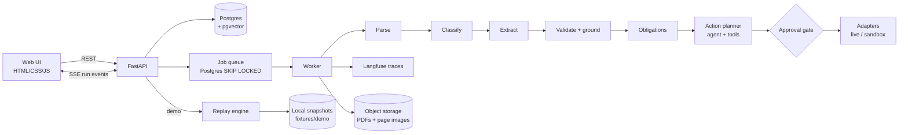

# Paperbound: Architecture

> Drop in any PDF. Paperbound tells you what it says, what you owe, and by when, then sets it up so nothing slips.

This doc is the source of truth. Update it before changing behavior.

---

## 1. Goals and non-goals

**Goals**
- Turn any messy PDF (scanned, native, mixed) into structured fields with provenance (page + bounding box).
- Detect obligations (deadlines, renewals, expirations, payments) and propose actions.
- Use deterministic code wherever it works; use LLMs only where rules cannot decide.
- Make every decision traceable and every quality claim measurable (eval harness).
- Ship one public app where anyone can upload a PDF or try a sample that needs no upload and costs nothing per click.

**Non-goals (v1)**
- Multi-tenant auth, billing, teams.
- Sending email directly (drafts only).
- Fine-tuning models.

---

## 2. Run modes

One public app, no deploy modes and no access code. A visitor either uploads their own PDF or tries a sample.

| Run | Trigger | Pipeline | Actions | LLM cost |
|---|---|---|---|---|
| `live` | **Upload** (button or drag and drop) | Real, end to end, in a background worker | Approval gate, then sandbox adapters on the server | Yes, within the daily budget |
| `sample` | **Try a sample** (Lease, Insurance certificate) | Replays a recorded real run from a local snapshot, with narration | Sandbox adapters only (in the browser) | Zero, and no database calls |

Uploads are on whenever `DATABASE_URL` and `OPENAI_API_KEY` are both set. If either is missing the page shows samples only, with a short note saying why. Samples always work, even with a paused database or an exhausted budget.

Both kinds of run stream **the same events** (`meta`, `step` with narration, `field`, `obligations`, `brief`, `action`, `done`), so the page has one renderer. The only differences are where the events come from (`/demo/<fixture>/events` or `/runs/<id>/events`) and where approvals go (browser sandbox or server).

**Sample (demo) design**
- Samples **never touch Supabase or OpenAI**. It reads a local snapshot committed to the repo, so it works even when the database is paused or the API key is out of credit.
- Snapshots are **real recorded runs**, not hand-made data. `scripts/record_demo.py` runs the live pipeline once on a curated sample PDF and exports the full run to `fixtures/demo/<fixture>/`:

```
fixtures/demo/lease/
  source.pdf
  pages/1.png, 2.png, ...        rendered page images
  snapshot.json                  document, pages (words + bboxes), steps, fields, obligations, proposed actions
  narration.json                 explanatory comment per step (hand-editable)
```

- **Replay engine** (`paperbound/demo/replay.py`) loads the snapshot and streams step events over the same SSE endpoint shape as live runs, using each step's original relative timing (capped at 1.5s per step). The frontend cannot tell the difference except for the badge.
- **Narration for a live feel**: each step event carries a `narration` string that explains what is happening and why, shown in the timeline as it streams. Examples:
  - parse: "Page 3 has no usable text layer, so it would be routed to OCR."
  - validate: "11 of 12 fields were found word-for-word on the page. The rent amount was not, so its confidence drops."
  - obligations: "The lease ends 2027-03-31 with 90 days' notice, so notice is due by 2026-12-31."
  - gate: "Calendar events are reversible, so this one only needs a single approval."
  `record_demo.py` drafts narration from each step's `reason` field; it is then edited by hand and committed.
- **Progressive reveal**: fields appear one at a time as the extract step streams, and bbox highlights animate in, so the run feels live.
- The UI shows a badge: `Sample run · recorded <date> · as of <AS_OF>`. This keeps it honest when an interviewer asks "is this real?" A live run's badge reads `Your document · live run · as of <date>`.
- **Approvals in a sample** run against sandbox adapters implemented **in the browser** (Sandbox Calendar, Sandbox Inbox, Webhook log panels). Nothing is sent to the server or persisted; refreshing the page resets the demo.

**Implementation status (demo mode)**
- `scripts/record_demo.py` runs the live pipeline (no database) as of `AS_OF` (default 2026-10-22) on `lease.pdf` and `insurance_certificate.pdf` and writes `fixtures/demo/lease/` and `fixtures/demo/insurance_certificate/`: `source.pdf`, `pages/<n>.png`, `snapshot.json` (document and classification, pages with words and boxes, steps with timings, fields with boxes, obligations, brief, proposed actions with groups, totals, `recorded_at`, `as_of`, `model`) and `narration.json` (`intro`, `steps` by stage plus `gate`, `actions` by group key or `tool:<name>`, `outro`). Narration is drafted from the recorded data and then edited by hand; re-recording never overwrites an existing `narration.json` unless `--redraft`. Links inside recorded reminders are written as `/#demo=<fixture>&page=<n>`.
- `paperbound/demo/replay.py` builds the whole replay as a list of (wait, event, data) and streams it as SSE. Events: `meta` (badge, narration intro), `step` (a `running` event, then the finished one with narration), `field` (phase `extracted` while the extract step streams, then phase `validated` with confidence, flags and boxes while validate streams), `obligations`, `brief`, `action` (one per proposal), a synthesized `gate` step, and `done`. Each step is replayed in its recorded duration capped at 1.5 s, with a 0.3 s floor so a step that took no time stays readable (`?speed=0` sends everything at once, used by tests). The module imports no database, no OpenAI and no pipeline code; a test imports it in a clean process and asserts that.
- The page cannot tell a replay from a live run except for the badge: it reuses the same renderers.

**Implementation status (public uploads)**
- `POST /documents` saves the file, creates a `queued` run and a job, writes the first `meta` event and returns at once. `paperbound/jobs.py` holds the queue, the worker and the event writer: one worker task, started in the FastAPI lifespan, claims the oldest queued job with `SELECT ... FOR UPDATE SKIP LOCKED` and runs the pipeline in a thread. `run_pipeline` takes an `observer` that is told when each stage starts and ends; the worker turns those into stored rows (steps, fields, obligations, actions) and `run_events` rows.
- Narration for live runs comes from `paperbound/narration.py`, the same templates `scripts/record_demo.py` uses to draft `narration.json`. It is code, not an LLM.
- `GET /runs/{id}/events` replays stored events from the database and then follows new ones (polling every 0.4 s, a heartbeat every 15 s). Each frame has an `id:` (its sequence number), so a reconnecting `EventSource` sends `Last-Event-ID` and receives only what it missed; `?after=<seq>` does the same. Replayed `action` events are refreshed with the action's current status, so a reopened run shows what was already approved. The stream ends after `done`, or when the run is finished and has nothing left to send.
- A job interrupted by a restart is ended at the next start: its run becomes `failed` and its stream receives a final `done`.
- Live `meta` arrives twice: at upload (document id, page count, no type yet) and again after classification (type and classification). The renderer merges them.

---

## 3. System overview



**Process layout**
- One process on Fly.io: FastAPI serves the UI, REST, SSE and the sample replay, and a single background worker task (started in the lifespan) runs queued jobs. A second task deletes expired uploads every 15 minutes. Both start only when uploads are available (`DATABASE_URL` and `OPENAI_API_KEY` set).
- The queue is the `jobs` table; more workers could be added later without code changes because jobs are claimed with `FOR UPDATE SKIP LOCKED`.

**Database: Supabase (dev and prod)**
- Supabase Postgres is used from day one, including local development. No local Docker database.
- Connect through the **session pooler** (port 5432). Not the direct connection (IPv6-only) and not the transaction pooler (port 6543), because `LISTEN/NOTIFY` and `SKIP LOCKED` workers need session-level connections.
- `pgvector` enabled via `create extension if not exists vector;`.
- Schema managed with Alembic migrations against `DATABASE_URL`.
- Keep the connection pool small (`pool_size=5`, `max_overflow=0`) to stay within free-tier limits.
- Free-tier projects pause after about a week of inactivity; demo mode does not depend on the database, so it keeps working regardless.

**Public uploads: sessions, limits, privacy** (`paperbound/deploy.py`, `sessions.py`, `usage.py`, read from the environment on each request)
- **Availability**: uploads need `DATABASE_URL` and `OPENAI_API_KEY`. Without them `POST /documents` answers 503 (before touching the database), `GET /config` says why, and the page offers samples only. The app starts with neither (the SQLAlchemy engine is created on first use).
- **Session ownership**: the first page load issues a signed (HMAC-SHA256 with `SESSION_SECRET`), `HttpOnly`, `SameSite=Lax` cookie (`Secure` over https, 7 days). It holds a random token; only the sha256 of the token (the session hash) is stored, on `documents.session_hash` and `runs.session_hash`. Every non-sample read endpoint (run, steps, fields, obligations, brief, actions, events, pages, stored files) and approve/reject answers **404, the same as for an id that does not exist**, unless the run belongs to the caller's session. A document is reachable only through a run of the caller's session. Rows from before sessions existed have no hash and are visible to nobody. Without `SESSION_SECRET` a random per-process secret is used (everything works, but visitors lose their runs when the process restarts), so set it in production.
- **Guardrails**, in order, for each upload: delete expired uploads, per-IP rate limit (5 per hour, keyed on a hash of `Fly-Client-IP`, else the socket address; every request counts, even if the file is later rejected), the daily LLM budget (`DAILY_LLM_BUDGET_USD`, default 1.00: the ledger's spend since midnight UTC plus an allowance of `RUN_COST_ESTIMATE_USD`, default 0.02, for every queued or running job, because runs are asynchronous and a burst of uploads would otherwise all pass before the first recorded its cost), the size limit (10 MB, read bounded), the PDF check, the page limit (20, checked after parsing and before anything is saved or any model is called). When the budget is used up `GET /config` reports `budget_exhausted` and the page replaces Upload with "Daily limit reached, try a sample".
- **Privacy**: files and everything derived from them are deleted 24 hours after upload (`documents.expires_at`, extended if the same file is uploaded again; rows without one are never touched). The page says so under the Upload button: "Files are deleted after 24 hours. Don't upload sensitive documents."
- `usage_ledger`: one `upload` row per counted request (IP hash only) and one `llm` row per run (its cost). It survives the deletion of uploads, so limits cannot be reset by expiry.
- `GET /config` tells the page what is available and the limits; `GET /healthz` is for the platform.
- `Dockerfile` (python slim, `requirements-prod.txt`), `.dockerignore` and `fly.toml` are provided (live uploads with a volume, `alembic upgrade head` as the release command); nothing is deployed from the repo.

**File storage**
- Local `STORAGE_DIR` in development; Supabase Storage in production, behind one `Storage` interface (`save`, `open`, `url`).

No Redis in v1. The queue is a `jobs` table with `SELECT ... FOR UPDATE SKIP LOCKED`. Run events are rows in `run_events`; the API streams them over SSE by polling that table (simple and reconnect-safe; `LISTEN/NOTIFY` could replace the polling later).

---

## 4. Pipeline stages

Each stage writes a `step` row (input summary, output summary, duration, cost, model, decision reason) and emits an SSE event.

### 4.1 Parse (deterministic first)
Per page, choose the cheapest route that works:
1. **Text layer** (PyMuPDF): if the page has extractable text with sane character density, use it, with word-level bounding boxes.
2. **OCR** (Tesseract via pytesseract): if text layer is missing or garbled.
3. **Vision LLM** (GPT-4o-mini with image input): if OCR confidence is below threshold or the page is table-heavy and messy.

Tables: pdfplumber on text-layer pages.
Output: `pages` rows with `route`, `text`, `words[] {text, bbox}`, `quality_score`.

### 4.2 Classify (`pipeline/classify.py`)
A `classify` step between parse and extract records the decision, its reason, and (when used) the model, tokens and cost.
- **Heuristics first (free)**: each type has weighted key phrases (for example "certificate of liability insurance" 4, "certificate holder" 3, "landlord" 2, "base rent" 2), each counted once. Layout signals add to a type that already has hits: a key phrase in the first four lines of page 1 (+4, the title), at most two pages for a certificate (+1), three or more pages for a lease (+1). The top type is accepted only if it scores at least 6 and leads the runner-up by at least 4.
- **LLM fallback, only when unsure**: if the heuristics are not clear (mixed signals, or no hits at all), gpt-4o-mini classifies from the first two pages (4000 characters) into a fixed enum with a one-sentence reason. The document text is marked untrusted in the prompt, and the enum means an injected instruction cannot invent a type.
- Types today: `lease`, `insurance_certificate`, `other`. Later types (contract, invoice, receipt, permit, notice) are added to the enum, the heuristics table and `doctypes.py`.
- `other` stops the run after classification with status `done` and the message "document type not supported yet" (API field `message`, shown in the UI). A classifier failure makes the run `partial` and skips everything after it.
- The detected type is stored on `documents.doc_type` and returned by `GET /runs/{id}` with the classify step's summary and reason.

### 4.3 Extract (schema-constrained)
- Each doc type has a Pydantic schema in `schemas/` (e.g. `LeaseFields`, `InsuranceCertFields`).
- `other` uses a generic schema: parties, dates, amounts, obligations, summary.
- LLM extraction uses structured outputs (`gpt-4o-mini`, temperature 0, one call per document). Every field returns `{value, source_quote, page}`. The system prompt states that document text is untrusted data and instructions inside it must be ignored; quotes must be verbatim and at most 30 words; rent is the first-year base rent, not escalation-table values. Currently only the `lease` schema exists (`schemas/lease.py`: landlord, tenant, premises_address, start_date, end_date, rent_amount, rent_period, notice_period_days, and for the decision brief holdover_rate_percent, security_deposit, notice_method, notice_section, rent_escalation_percent, current_rent). The user message starts with today's date (from `clock.today()`) so the model can pick the rent-table row that covers it (`current_rent`).
- `insurance_certificate` uses `InsuranceCertFields` (`schemas/insurance.py`): insured, certificate_holder, producer, and `policies`, a list (at most 6) where each policy has type, insurer, number, effective_date, expiration_date, each_occurrence_limit and aggregate_limit, each as `{value, source_quote, page}`. One extraction call per document, with its own untrusted-data prompt (quotes should include their label, such as "EACH OCCURRENCE $1,000,000", so they identify the right place). Policy fields are flattened to `policy_1.number`, `policy_1.expiration_date`, ... in `fields`.
- Long docs: chunk by page, retrieve relevant chunks per field group with pgvector, then extract.

### 4.4 Validate and ground (deterministic)
- **Type and range checks**: dates parse, amounts non-negative, end date after start date.
- **Cross-field checks**: line items sum to total; notice deadline = end date minus notice period.
- **Grounding check**: fuzzy-match `source_quote` (rapidfuzz `fuzz.ratio` on punctuation-stripped, case-folded tokens) against the page's word list using a sliding window over consecutive words (window size = quote length ± 2 words). The best window gives a score from 0 to 1 and the union bbox of its words. The page the model named is searched first; other pages are searched only if that page scores below 0.8, so a wrong page number is recovered (flag `page_corrected`). A score below 0.8 flags the field `ungrounded` and drops the bbox.
- **Value-in-quote check**: the extracted value must appear in or be derivable from its quote (`$8,500.00` or "Eight Thousand Five Hundred Dollars ($8,500.00)" → 8500; "March 31, 2027" → 2027-03-31; "ninety (90) days" → 90). If not, the field gets `value_not_in_quote`.
- **Field confidence** = `0.6 * grounding_score + 0.3 * validators_passed + 0.1 * page_quality`. `validators_passed` is 1 only if the type/range/cross-field checks and the value-in-quote check all pass, else 0. `page_quality` is the quality score of the page the field was grounded on. No reliance on the LLM's self-reported confidence. A field the model could not find has confidence 0 and flag `not_found`.
- **Quote rules (injection hardening)**: the quote must look like text that can state the field. `rent_amount`: a currency amount (`$` or `USD` followed by digits). `start_date` / `end_date`: a date. `notice_period_days`: a number directly followed by "day(s)". `security_deposit` / `current_rent`: a currency amount. `holdover_rate_percent` / `rent_escalation_percent`: a `%` or "percent". `notice_method`: a delivery word (mail, courier, deliver, written...). `notice_section`: a "section"/"article"/"clause" word or a numbered heading. Failing adds `quote_rule_failed`.
- **Instruction detector**: a quote containing instruction-like text (`ignore`, `disregard`, `instruction(s)`, `assistant`, `system:`, `set X to`) gets `suspicious_instruction`. Its confidence is capped at 0.3, and it is never used for obligations or actions. This is a deliberately blunt regex and will produce false positives on lease text such as "written instructions"; a false positive costs a human review, a false negative costs trust.
- **Rent table cross-check**: if the extracted `rent_amount` differs from the first row of a rent escalation table on any page (`Lease Year | Period | Monthly Base Rent`), it gets `conflicting_values`.
- **Short quotes must match exactly**: a quote of three words or fewer is `ungrounded` unless it scores 1.0. Without this, "Section 11" fuzzy-matched "Section 16" and the UI would have highlighted the wrong clause.
- **Normalization by code**: `notice_section` is reduced to its identifier ("11. Renewal; Termination at Expiration" becomes "Section 11"); percentages must be in (0, 1000], else `invalid_percent`.
- **Current-rent cross-check**: the rent table is parsed into rows (`Lease Year | Period | Monthly Base Rent`); if a row covers today and `current_rent` differs from it, the field gets `conflicting_values`.
- **`validators_passed`** is 0 if any of `invalid_date`, `end_before_start`, `invalid_amount`, `invalid_notice_period`, `invalid_percent`, `value_not_in_quote`, `quote_rule_failed`, `conflicting_values` is present. Fields carrying any of these, or `ungrounded`, `suspicious_instruction`, `not_found`, are "blocked": they are never used for obligations or shown to the action planner.
- **Certificates** use the same checks, keyed by the field's own name (`policy_2.expiration_date` is checked like a date): dates, currency amounts for limits, a policy number must contain a digit and appear in its quote, `effective_date` must precede `expiration_date` (`end_before_start`). Quotes of three words or fewer must match exactly, which matters here because a bare policy number or date is a short quote.
- **Per-line boxes**: grounding returns one bbox per text line (matched words grouped by line); the field stores them as `bboxes`, plus their union as `bbox`.
- **Flags**: `not_found`, `ungrounded`, `page_corrected`, `value_not_in_quote`, `invalid_date`, `end_before_start`, `invalid_amount`, `invalid_notice_period`, `invalid_percent`, `quote_rule_failed`, `suspicious_instruction`, `conflicting_values`.

### 4.5 Obligations
Deterministic derivation from validated fields (no LLM). An obligation is skipped, with the reason recorded on the step, if an input is missing, `ungrounded`, or failed validation:
- `deadline` (date, what, source field)
- `recurring` (rent, premium, renewal)
- `expiration`

Example: lease end 2027-03-31 + 90-day notice → obligation "Send renewal or termination notice by 2026-12-31".

For a certificate: one `expiration` obligation per policy whose expiration date is usable ("General Liability GL-5521904 expires 2027-01-15: request a renewed certificate of insurance before then").

### 4.5b Decision brief (`pipeline/impact.py`, deterministic, no LLM)
A pipeline step (`impact`) between obligations and the planner, and `GET /runs/{id}/brief` (recomputed from the stored fields, so days remaining stay current). It uses grounded, non-blocked fields only. Each line carries the names of the fields it came from (the API maps them to field ids, pages and boxes):
- `deadline` and `days_remaining` (same rule as the obligation, so they cannot disagree)
- `current_rent`, and `next_rent` = current rent plus one more escalation step (labelled illustrative: this lease sets the renewal rent separately)
- `holdover_rent` = current rent x holdover rate, `holdover_extra` = holdover rent minus current rent, `holdover_percent` (assumes the current rent is still in effect at expiration)
- `notice_method`, `notice_section`, `security_deposit`
Money uses `Decimal` rounded half up to cents. A line whose inputs are missing or blocked is skipped and the reason is recorded (step reason, API `skipped`, UI "Not available").

**Certificates** (`build_coi_brief`): `earliest_expiration` and `days_remaining` (across policies with a usable expiration; a blocked policy is left out and the line's note says so), `expiring_soon` (policies with 60 days or fewer left, including expired ones; each named, each cited, "None" when there are none), and one `limit_check_N` per policy: its each-occurrence limit against a minimum (`COI_MIN_EACH_OCCURRENCE`, default 1,000,000; equal meets it). Every line cites the policy fields it came from.

**One clock**: `paperbound/clock.py` `today()` is the only source of "today" (extraction prompt, rent-table row selection, brief, reminder dates). A date parameter wins, then the `AS_OF` environment variable (YYYY-MM-DD, a bad value is an error), then the system date. `run_pipeline(today=...)` passes one date to every stage.

### 4.6 Action planner (agent)
The planner is shared by all document types; what differs lives in `agent/profiles.py` (a profile per type: system prompt, tokens, the email variants and their required tokens, the facts block appended to reminders, and the tracker record). The rules below are the lease profile; the certificate profile follows them.
An LLM agent (`agent/planner.py`, gpt-4o-mini with tool calling) receives a deterministic doc summary, the usable (non-blocked) fields with local ids, and the derived obligations, and proposes actions. It does not execute them. Rules enforced in code, not just in the prompt:
- Every action must cite `source_field_ids` that exist in the list it was shown; proposals with none, or unknown ids, are rejected and the model is told why.
- Email recipients and webhook URLs are never taken from the model or the document: `draft_email` is stored with `to: {{RECIPIENT}}` and `fire_webhook` with `url: {{WEBHOOK_URL}}`, and any such args from the model are dropped.
- **The model writes prose only; code supplies every number, date and name.** The model puts `{tokens}` (`{deadline}`, `{current_rent}`, `{landlord}`, `{notice_section}`...) in its text and code substitutes them from the brief and grounded fields. A proposal is rejected if it uses an unknown or unavailable token, or if any date or number the model typed literally does not match the brief. Spelled-out numbers are not checked.
- **Staged reminders**: one `create_calendar_event` for each of 60, 30 and 14 days before the deadline that is still in the future (code computes the dates; any other date is rejected). The model writes the title and an intro sentence; code appends the clause quote and page, the notice method and section, the holdover consequence, and a link `/#run={id}&page={n}` to the source page. Reminders form one `bundle` group.
- **Two email drafts**, `variant` `renew` and `terminate`, each the tenant's formal notice to the landlord. Code requires each to cite the landlord, tenant, deadline, notice section and current rent (whichever are available) and to say renew / terminate. Both share one `exclusive` group: approving one auto-rejects the other.
- **Tracker record**: one `upsert_record` (obligation) built entirely by code from the brief (deadline, counterparty, premises, current rent, holdover risk, status `decision needed`). The model cannot propose it.
- Names (landlord, tenant) come from grounded fields; recipient and URLs stay placeholders.
- The action's `source_field_ids` are the model's ids plus every field the inserted text draws on.
- Duplicate proposals are rejected. The planner runs `get_obligations` itself before the model proposes anything (it counts as one of the 12 tool calls) and passes the result in.
- If staged proposals are still missing after a round, the model is told what is missing (at most 4 model rounds).
- The planner is skipped when there are no obligations. A planner failure makes the run `partial` but keeps fields and obligations.
- **Certificate profile**: the same 60/30/14-day reminders before the earliest expiration (future dates only), each with code-built policy lines (type and number, expiry, each-occurrence limit and whether it meets the minimum), the quote and page of the earliest policy's expiration, and a source link; **one** `draft_email` (`variant` `request_certificate`) from the certificate holder to the insured asking for a renewed certificate, required to contain `{insured}`, `{certificate_holder}` and `{earliest_expiration}` and to mention a renewed certificate (recipient stays `{{RECIPIENT}}`; one draft, so no exclusive group); and a code-built tracker record (deadline, insured, holder, per-policy expiry and limit check, status `renewal needed`). The same token substitution and number-mismatch rejection apply.
- The loop ends when everything expected was proposed. Typical cost is one planner call; rejections add rounds.

### 4.7 Approval gate
Policy (in `policy.py`, deterministic):

| Condition | Result |
|---|---|
| Read-only tool | Auto |
| Reversible action (calendar event, record upsert) AND all source fields confidence ≥ 0.9 | Auto-approve (configurable, off by default) |
| Anything else | Pending human approval |
| `draft_email` | Always a draft, never sends |

---

## 5. Agent tools

All tools implement one interface:

```python
class Tool(Protocol):
    name: str
    side_effect: bool          # False = read-only
    reversible: bool
    def schema(self) -> dict: ...
    async def run(self, args: dict, ctx: RunContext) -> ToolResult: ...
```

Action tools have two adapters, `live` and `sandbox`, selected by `ctx.mode`.

**Context tools (read-only)**

| Tool | Does |
|---|---|
| `search_documents` | pgvector search over past docs and chunks |
| `get_entity` | Look up a known counterparty (vendor, landlord) |
| `compare_documents` | Field-level diff against a prior version of the same doc |
| `get_obligations` | Existing obligations, to avoid duplicates |
| `ask_human` | Creates a clarification question on the run; pauses that action |

**Action tools (side effects)**

| Tool | Live adapter | Sandbox adapter |
|---|---|---|
| `create_calendar_event` | Google Calendar API | Sandbox Calendar panel |
| `upsert_record` | `obligations` table | Session-scoped table |
| `draft_email` | Gmail API (create draft) | Sandbox Inbox panel |
| `fire_webhook` | HTTP POST to user URL | Logged request/response viewer |

`proposed_actions.group_key` / `group_mode` (`bundle` or `exclusive`) record grouping. Approving an action in an `exclusive` group rejects its still-pending siblings in the same run.

Every proposed action stores `source_refs[]` (field ids → page + bbox) so the UI can show "because of page 12, clause 4.2".

**Agent loop limits**: max 12 tool calls and 4 model rounds per run (raised from 8 when the plan grew from 2 to 5 model-proposed actions), 60s timeout, and a dedupe check against `get_obligations` before proposing.

**Implementation status**: all six tools exist in `agent/tools/` (one file each). Action tools have a working `sandbox` adapter (writes a `sandbox_actions` row with the full args and a fake response); the `live` adapters raise "not connected". `get_entity` is a stub returning `null` (no `entities` table yet). `get_obligations` returns obligations stored by earlier runs of the same document. Approving an action (`POST /actions/{id}/approve`) runs the sandbox adapter and records an `action_results` row; rejecting only changes the status. A decided action cannot be decided again (409).

---

## 6. Data model

```
documents        id, filename, storage_key, sha256, page_count, doc_type, created_at, expires_at (the cleanup job deletes only rows that have one), session_hash (uploader)
pages            id, document_id, page_no, route, text, words_json, quality_score, image_key, width_pt, height_pt  (bboxes are PDF points; width/height let the UI scale them)
chunks           id, document_id, page_no, text, embedding vector(1536)
runs             id, document_id, status (queued|running|done|partial|failed), started_at, finished_at, cost_usd, session_hash (owner)
steps            id, run_id, seq, stage, status, input_summary, output_summary, reason, model, tokens, cost_usd, duration_ms, ts_offset_ms
fields           id, run_id, name, value_json, source_quote, page_no, bbox, bboxes (one box per matched line; bbox is their union), confidence, flags[]
obligations      id, run_id, kind, due_date, description, source_field_ids[]
proposed_actions id, run_id, tool, args_json, source_field_ids[], rationale, status (pending|approved|rejected|executed|failed), policy_reason, group_key, group_mode (bundle|exclusive), created_at
usage_ledger     id, kind (upload|llm), ip_hash (sha256 of the client address), usd, created_at  (rate limit and daily LLM budget; kept after uploads expire)
action_results   id, action_id, adapter (live|sandbox), response_json, executed_at
sandbox_actions  id, run_id, action_id, tool, args_json, response_json, created_at   (what sandbox adapters "did": full args + fake response)
entities         id, name, kind, aliases[], attrs_json
jobs             id, run_id (unique), status (queued|running|done|failed), payload (parse_ms, reused), error, created_at, started_at, finished_at
run_events       id, run_id, seq, name, data  (every event a run streamed, in order; unique on (run_id, seq))
eval_runs        id, dataset, config_json, metrics_json, created_at
```

`steps` also has an `error` column (text, set when a stage fails) and a unique constraint on `(run_id, seq)`. `status` is `done`, `failed` or `skipped` (stages after a failed extract are recorded as `skipped`). `input_summary`/`output_summary` are short human-readable strings; the API exposes `output_summary` as `summary`. `runs.status` is `queued`, `running`, `done`, `partial` (parse succeeded but a later stage failed) or `failed` (the run crashed or was interrupted).

`sha256` on documents gives idempotency: the same file uploaded twice reuses parse results (a new run is still created for each upload and extraction runs again). Two visitors uploading the same file share the stored document but each owns their own run.

Only live runs are stored in the database. Samples exist only as files in `fixtures/demo/`.

---

## 7. API

```
POST   /documents                 upload PDF → {document_id, run_id, status: "queued", page_count, reused} at once; 503 if uploads are unavailable, 413/429 limits, 400 not a PDF
GET    /runs/{id}                 run summary (status, page_count, doc_type, classification, message for unsupported types)
GET    /runs/{id}/events          SSE: stored events, then live ones; Last-Event-ID or ?after=<seq> to resume
GET    /runs/{id}/fields          extracted fields with provenance
GET    /runs/{id}/steps           pipeline steps (timeline), ordered by seq
GET    /runs/{id}/obligations     derived obligations
GET    /documents/{id}/pages/{n}  page image URL + word boxes
GET    /files/{key}               a stored page image or PDF
GET    /runs/{id}/brief           decision brief: numbers with their source fields (recomputed, no LLM)
GET    /runs/{id}/actions         proposed actions (with group_key / group_mode)
POST   /actions/{id}/approve      execute via the sandbox adapter (exclusive groups reject their siblings)
POST   /actions/{id}/reject
GET    /demo/fixtures             available samples (from fixtures/demo/<fixture>/)
GET    /demo/{fixture}/events     SSE replay of the snapshot with narration (no DB); ?speed=0 for no waiting
GET    /demo/{fixture}/pages/{n}  snapshot page: word boxes + image_url
GET    /demo/{fixture}/pages/{n}/image.png   the recorded page image
GET    /config                    uploads on/off and why, budget_exhausted, limits, the privacy note
GET    /healthz                   platform health check
GET    /evals                     the newest saved result of each eval fixture (HTML)
```

Everything under `/runs`, `/documents`, `/files` and `/actions` is checked against the caller's session cookie and answers 404 to anyone else. `/demo`, `/config`, `/healthz` and `/evals` are public.

SSE events (identical for samples and live runs; each live frame also carries `id: <seq>`):

| event | data |
|---|---|
| `meta` | `badge`, `narration` (intro), `filename`, `page_count`, `doc_type`, `classification`, `as_of`, `model`; samples add `fixture`, `label`, `recorded_at`; live runs add `live`, `document_id`, `run_id`. May arrive twice (type known after classify); fields merge |
| `step` | `seq`, `stage`, `status` (`running`, then `done`, `failed` or `skipped`), `summary`, `reason`, `error`, `model`, `tokens`, `cost_usd`, `duration_ms`, `narration`. Stages: parse, classify, extract, validate, obligations, impact, planner, then a synthesized `gate` |
| `field` | `phase: extracted` (name, value, page_no, source_quote), then `phase: validated` (adds id, bboxes, confidence, flags) |
| `obligations` | `{obligations: [{kind, due_date, description, source_field_ids}]}` |
| `brief` | `{lines: [{key, label, value, text, note, sources}], skipped}` |
| `action` | one proposed action with sources, group, status, `result` and a `narration` |
| `done` | `status`, `doc_type`, `message` (set for unsupported types or a failed run), `tokens`, `cost_usd`, `narration` (closing line) |

---

## 8. UI (plain HTML, CSS and JS; no framework)

Files: `web/index.html` (structure), `web/style.css` (design), `web/app.js` (the one renderer). The page is tested under node on a small DOM stub (`tests/ui/`) and by reading the HTML and CSS.

**Landing.** Header (Paperbound, How it works, Evals, GitHub), the line "Drop in any PDF. See what you owe, and by when.", an **Upload** button (drag and drop onto the card works too), a **Try a sample** dropdown (Lease, Insurance certificate), "Supports leases and insurance certificates", the privacy note under Upload, and a five-step strip: Read (code), Extract (LLM), Verify (code), Decide (code), Act (LLM drafts, you approve), each with a one-line explanation on hover or focus. If uploads are unavailable the button is replaced by a short note; if the daily budget is used up it reads "Daily limit reached, try a sample".

**Run view.** A compact horizontal stepper (the five steps above, mapped onto the pipeline stages: Read = parse + classify, Extract = extract, Verify = validate, Decide = obligations + impact, Act = planner + gate) with a status dot each, and the current step's narration as one line under it (click to expand). Clicking a step opens its details in the Trace tab. Below it, two columns: a document viewer on the left (each column scrolls inside itself, so the Summary needs no page scroll on a desktop) and a tabbed panel on the right:

- **Summary** (default): document type, file, parties, 2 to 4 cards with a large number and a small label (each clickable: it highlights its source on the page), and one **Next decision** line that links to the Actions tab.
- **Actions**: grouped cards, each with a "Why: page N" link per page of evidence and Approve / Reject: Reminders (Approve all), "Notice: choose one", Tracker record. An approved action shows its sandbox result in place (calendar entry, draft email, record). The tab shows how many actions wait.
- **Fields**: a compact table (field, value, confidence chip, flags); a row highlights its source. Rows appear as the model returns them (`checking`) and settle once code has verified them.
- **Trace**: the full narrated timeline, a model or code tag per step, tokens, cost, latency, and a link to `/evals`.

**Unsupported types** get a friendly card ("This looks like a document type Paperbound doesn't recognize. Paperbound supports leases and insurance certificates today.") with a Try a sample dropdown.

**Routing** is by URL hash: `#run=<id>` opens a run (a reloaded or shared tab replays it from the database, if it is the same browser), `#demo=<fixture>` opens a sample, and `#run=<id>&page=<n>` / `#demo=<fixture>&page=<n>` (written into reminders) scroll to a page.

**Approvals**: a sample's approvals run in browser-side sandbox adapters with no server calls (a refresh resets them); a live run's go to `POST /actions/{id}/approve|reject`, after which the page re-reads the run's actions to pick up what the server did to the rest of the group.

**Design.** CSS variables for a neutral palette and one accent (plus green, amber and red for status only); Inter from Google Fonts; an 8px spacing scale; rounded cards with subtle borders; light and dark by `prefers-color-scheme`; responsive down to 375px (the tabs stack under the viewer and the page scrolls); subtle animation only, and none with `prefers-reduced-motion`.

---

## 9. Evals

Run via `python -m paperbound.evals --dataset <name>`; results stored in `eval_runs` and published to the README.

**Today**: `scripts/eval_fixtures.py` runs every `fixtures/demo/*.expected.json` (each names its `doc_type`, its `pdfs` and an `as_of` date) and prints one table per document type. Date-dependent expectations are recomputed from the expected data, independently of the code under test, so the results do not drift with the calendar.

| Dataset | Measures |
|---|---|
| CORD (receipts) | Field-level precision, recall, F1 |
| SROIE (receipts, scanned) | Field-level F1, OCR route vs vision route |
| CUAD (contracts) | Obligation-relevant clauses: expiration date, renewal term, notice period |
| `fixtures/labeled/` (~20 hand-labeled docs) | End to end: correct obligations and correct proposed actions |

**Reported metrics**
- Field F1 per doc type.
- **Grounding rate**: share of fields with a recovered bbox.
- **Calibration**: accuracy within confidence buckets.
- **Parser routing**: accuracy, cost, and latency per route; share of pages handled without a vision LLM.
- **Action precision**: share of proposed actions a labeler would approve.
- Cost and latency per document.

---

## 10. Observability

- Langfuse trace per run; one span per stage and per tool call, linked by `run_id`.
- The `steps` table mirrors the key info so the UI and demo replays do not depend on Langfuse.
- Structured JSON logs with `run_id` on every line.

---

## 11. Repo layout

```
paperbound/
  api/            FastAPI app (main.py), routes (uploads, runs, events, actions, files)
  demo/           replay.py (SSE replay engine), routes.py (no database, no OpenAI)
  deploy.py       availability and limits;  usage.py  rate limit, LLM budget, expiry;  sessions.py  signed session cookie
  jobs.py         job queue, the in-process worker, and the writer of the run event stream
  narration.py    per-step narration templates (used by record_demo.py and by live runs)
  presenters.py   JSON shapes shared by REST and the event stream;  evals_page.py  the /evals page
  clock.py        the single source of "today" (AS_OF override)
  doctypes.py     per-type wiring: extract, validate, obligations, brief
  pipeline/       parse.py classify.py extract.py validate.py obligations.py impact.py runner.py types.py
  agent/          planner.py profiles.py policy.py executor.py tools/ (one file per tool, live + sandbox adapters)
  schemas/        Pydantic field schemas per doc type (lease.py, insurance.py)
  evals/          datasets/, runners, metrics
  db/             models, migrations (Alembic)
web/              index.html, style.css, app.js
fixtures/demo/    <fixture>/ source.pdf, pages/*.png, snapshot.json, narration.json  (plus the source PDFs and *.expected.json used by the evals)
fixtures/labeled/ hand-labeled docs + ground truth JSON
scripts/          record_demo.py (live run → snapshot export), load_eval_data.py, make_sample_lease.py, make_sample_coi.py, eval_fixtures.py (record_demo.py is implemented)
evals/results/    JSON output of eval runs (eval_fixtures.py)
tests/            pytest unit tests (no network)
.env.example      committed; .env is local only and git-ignored
docs/architecture.md
```

---

## 12. Build phases

| Phase | Scope | Done when |
|---|---|---|
| 1 | Upload, storage, queue, parse (text + OCR), pages viewer | Page images render with word boxes |
| 2 | Classify, extract, validate, grounding, fields UI | Clicking a field highlights its source |
| 3 | Eval harness on CORD and SROIE | Field F1 in README |
| 4 | Obligations, agent, tools, approval gate, sandbox adapters | Lease fixture yields a calendar event and a draft email |
| 5 | Snapshot export, narration, replay engine, Run Demo button, in-browser sandbox adapters | Demo runs with zero LLM and zero database calls |
| 6 | Langfuse, CUAD eval, Fly.io deploy | Public URL live |

---

## 13. Stack

FastAPI, Postgres + pgvector (Supabase), Supabase Storage, PyMuPDF, pdfplumber, Tesseract, OpenAI (GPT-4o-mini, text-embedding-3-small), rapidfuzz, Langfuse, Alembic, plain HTML/CSS/JS, Fly.io.
