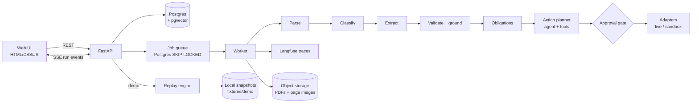

# Paperbound: Architecture

> Drop in any PDF. Paperbound tells you what it says, what you owe, and by when, then sets it up so nothing slips.

This doc is the source of truth. Update it before changing behavior.

---

## 1. Goals and non-goals

**Goals**
- Turn any messy PDF (scanned, native, mixed) into structured fields with provenance (page + bounding box).
- Detect obligations (deadlines, renewals, expirations, payments) and propose actions.
- Use deterministic code wherever it works; use LLMs only where rules cannot decide.
- Make every decision traceable and every quality claim measurable (eval harness).
- Ship a public demo with a **Run Demo** button that needs no upload and costs nothing per click.

**Non-goals (v1)**
- Multi-tenant auth, billing, teams.
- Sending email directly (drafts only).
- Fine-tuning models.

---

## 2. Run modes

| Mode | Trigger | Pipeline | Actions | LLM cost |
|---|---|---|---|---|
| `live` | User uploads a PDF | Real, end to end | Approval gate, then real adapters (if connected) or sandbox | Yes |
| `demo` | **Run Demo** button | Replays a recorded real run from a local snapshot, with narration | Sandbox adapters only (in-browser) | Zero, and no database calls |

**Demo mode design**
- Demo mode **never touches Supabase or OpenAI**. It reads a local snapshot committed to the repo, so it works even when the database is paused or the API key is out of credit.
- Snapshots are **real recorded runs**, not hand-made data. `scripts/record_demo.py` runs the live pipeline once on a curated sample PDF and exports the full run to `fixtures/demo/<fixture>/`:

```
fixtures/demo/lease/
  source.pdf
  pages/1.png, 2.png, ...        rendered page images
  snapshot.json                  document, pages (words + bboxes), steps, fields, obligations, proposed actions
  narration.json                 explanatory comment per step (hand-editable)
```

- **Replay engine** (`paperbound/demo/replay.py`) loads the snapshot and streams step events over the same SSE endpoint shape as live runs, using each step's original relative timing (capped at 1.5s per step). The frontend cannot tell the difference except for the badge.
- **Narration for a live feel**: each step event carries a `narration` string that explains what is happening and why, shown in the timeline as it streams. Examples:
  - parse: "Page 3 has no usable text layer, so it would be routed to OCR."
  - validate: "11 of 12 fields were found word-for-word on the page. The rent amount was not, so its confidence drops."
  - obligations: "The lease ends 2027-03-31 with 90 days' notice, so notice is due by 2026-12-31."
  - gate: "Calendar events are reversible, so this one only needs a single approval."
  `record_demo.py` drafts narration from each step's `reason` field; it is then edited by hand and committed.
- **Progressive reveal**: fields appear one at a time as the extract step streams, and bbox highlights animate in, so the run feels live.
- The UI shows a badge: `Demo replay · recorded <date> · model <name>`. This keeps it honest when an interviewer asks "is this real?"
- **Approvals in demo mode** run against sandbox adapters implemented **in the browser** (Sandbox Calendar, Sandbox Inbox, Webhook log panels). Nothing is sent to the server or persisted; refreshing the page resets the demo.

---

## 3. System overview



**Process layout**
- `api`: FastAPI, serves the UI, REST, SSE, and the replay engine.
- `worker`: pulls jobs from the Postgres queue and runs pipeline stages.
- Both are deployed on Fly.io.

**Database: Supabase (dev and prod)**
- Supabase Postgres is used from day one, including local development. No local Docker database.
- Connect through the **session pooler** (port 5432). Not the direct connection (IPv6-only) and not the transaction pooler (port 6543), because `LISTEN/NOTIFY` and `SKIP LOCKED` workers need session-level connections.
- `pgvector` enabled via `create extension if not exists vector;`.
- Schema managed with Alembic migrations against `DATABASE_URL`.
- Keep the connection pool small (`pool_size=5`, `max_overflow=0`) to stay within free-tier limits.
- Free-tier projects pause after about a week of inactivity; demo mode does not depend on the database, so it keeps working regardless.

**File storage**
- Local `STORAGE_DIR` in development; Supabase Storage in production, behind one `Storage` interface (`save`, `open`, `url`).

No Redis in v1. The queue is a `jobs` table with `SELECT ... FOR UPDATE SKIP LOCKED`, and run events are pushed via Postgres `LISTEN/NOTIFY` to the API, which fans out over SSE.

---

## 4. Pipeline stages

Each stage writes a `step` row (input summary, output summary, duration, cost, model, decision reason) and emits an SSE event.

### 4.1 Parse (deterministic first)
Per page, choose the cheapest route that works:
1. **Text layer** (PyMuPDF): if the page has extractable text with sane character density, use it, with word-level bounding boxes.
2. **OCR** (Tesseract via pytesseract): if text layer is missing or garbled.
3. **Vision LLM** (GPT-4o-mini with image input): if OCR confidence is below threshold or the page is table-heavy and messy.

Tables: pdfplumber on text-layer pages.
Output: `pages` rows with `route`, `text`, `words[] {text, bbox}`, `quality_score`.

### 4.2 Classify
- Cheap first pass: keyword and layout heuristics (e.g. "Certificate of Liability Insurance", "Lease Agreement").
- Fallback: LLM classification over the first 2 pages into a fixed set: `lease`, `contract`, `insurance_certificate`, `invoice`, `receipt`, `permit`, `notice`, `other`.

### 4.3 Extract (schema-constrained)
- Each doc type has a Pydantic schema in `schemas/` (e.g. `LeaseFields`, `InsuranceCertFields`).
- `other` uses a generic schema: parties, dates, amounts, obligations, summary.
- LLM extraction uses structured outputs (`gpt-4o-mini`, temperature 0, one call per document). Every field returns `{value, source_quote, page}`. The system prompt states that document text is untrusted data and instructions inside it must be ignored; quotes must be verbatim and at most 30 words; rent is the first-year base rent, not escalation-table values. Currently only the `lease` schema exists (`schemas/lease.py`: landlord, tenant, premises_address, start_date, end_date, rent_amount, rent_period, notice_period_days).
- Long docs: chunk by page, retrieve relevant chunks per field group with pgvector, then extract.

### 4.4 Validate and ground (deterministic)
- **Type and range checks**: dates parse, amounts non-negative, end date after start date.
- **Cross-field checks**: line items sum to total; notice deadline = end date minus notice period.
- **Grounding check**: fuzzy-match `source_quote` (rapidfuzz `fuzz.ratio` on punctuation-stripped, case-folded tokens) against the page's word list using a sliding window over consecutive words (window size = quote length ± 2 words). The best window gives a score from 0 to 1 and the union bbox of its words. The page the model named is searched first; other pages are searched only if that page scores below 0.8, so a wrong page number is recovered (flag `page_corrected`). A score below 0.8 flags the field `ungrounded` and drops the bbox.
- **Value-in-quote check**: the extracted value must appear in or be derivable from its quote (`$8,500.00` or "Eight Thousand Five Hundred Dollars ($8,500.00)" → 8500; "March 31, 2027" → 2027-03-31; "ninety (90) days" → 90). If not, the field gets `value_not_in_quote`.
- **Field confidence** = `0.6 * grounding_score + 0.3 * validators_passed + 0.1 * page_quality`. `validators_passed` is 1 only if the type/range/cross-field checks and the value-in-quote check all pass, else 0. `page_quality` is the quality score of the page the field was grounded on. No reliance on the LLM's self-reported confidence. A field the model could not find has confidence 0 and flag `not_found`.
- **Flags**: `not_found`, `ungrounded`, `page_corrected`, `value_not_in_quote`, `invalid_date`, `end_before_start`, `invalid_amount`, `invalid_notice_period`.

### 4.5 Obligations
Deterministic derivation from validated fields (no LLM). An obligation is skipped, with the reason recorded on the step, if an input is missing, `ungrounded`, or failed validation:
- `deadline` (date, what, source field)
- `recurring` (rent, premium, renewal)
- `expiration`

Example: lease end 2027-03-31 + 90-day notice → obligation "Send renewal or termination notice by 2026-12-31".

### 4.6 Action planner (agent)
An LLM agent with tools receives the doc summary, fields, and obligations, and proposes actions. It does not execute them.

### 4.7 Approval gate
Policy (in `policy.py`, deterministic):

| Condition | Result |
|---|---|
| Read-only tool | Auto |
| Reversible action (calendar event, record upsert) AND all source fields confidence ≥ 0.9 | Auto-approve (configurable, off by default) |
| Anything else | Pending human approval |
| `draft_email` | Always a draft, never sends |

---

## 5. Agent tools

All tools implement one interface:

```python
class Tool(Protocol):
    name: str
    side_effect: bool          # False = read-only
    reversible: bool
    def schema(self) -> dict: ...
    async def run(self, args: dict, ctx: RunContext) -> ToolResult: ...
```

Action tools have two adapters, `live` and `sandbox`, selected by `ctx.mode`.

**Context tools (read-only)**

| Tool | Does |
|---|---|
| `search_documents` | pgvector search over past docs and chunks |
| `get_entity` | Look up a known counterparty (vendor, landlord) |
| `compare_documents` | Field-level diff against a prior version of the same doc |
| `get_obligations` | Existing obligations, to avoid duplicates |
| `ask_human` | Creates a clarification question on the run; pauses that action |

**Action tools (side effects)**

| Tool | Live adapter | Sandbox adapter |
|---|---|---|
| `create_calendar_event` | Google Calendar API | Sandbox Calendar panel |
| `upsert_record` | `obligations` table | Session-scoped table |
| `draft_email` | Gmail API (create draft) | Sandbox Inbox panel |
| `fire_webhook` | HTTP POST to user URL | Logged request/response viewer |

Every proposed action stores `source_refs[]` (field ids → page + bbox) so the UI can show "because of page 12, clause 4.2".

**Agent loop limits**: max 8 tool calls per run, 60s timeout, and a dedupe check against `get_obligations` before proposing.

---

## 6. Data model

```
documents        id, filename, storage_key, sha256, page_count, doc_type, created_at
pages            id, document_id, page_no, route, text, words_json, quality_score, image_key, width_pt, height_pt  (bboxes are PDF points; width/height let the UI scale them)
chunks           id, document_id, page_no, text, embedding vector(1536)
runs             id, document_id, status, started_at, finished_at, cost_usd
steps            id, run_id, seq, stage, status, input_summary, output_summary, reason, model, tokens, cost_usd, duration_ms, ts_offset_ms
fields           id, run_id, name, value_json, source_quote, page_no, bbox, confidence, flags[]
obligations      id, run_id, kind, due_date, description, source_field_ids[]
proposed_actions id, run_id, tool, args_json, source_field_ids[], status (pending|approved|rejected|executed|failed), policy_reason
action_results   id, action_id, adapter (live|sandbox), response_json, executed_at
entities         id, name, kind, aliases[], attrs_json
jobs             id, run_id, stage, status, attempts, locked_at, error
eval_runs        id, dataset, config_json, metrics_json, created_at
```

`steps` also has an `error` column (text, set when a stage fails) and a unique constraint on `(run_id, seq)`. `status` is `done`, `failed` or `skipped` (stages after a failed extract are recorded as `skipped`). `input_summary`/`output_summary` are short human-readable strings; the API exposes `output_summary` as `summary`. `runs.status` is `running`, `done`, or `partial` (parse succeeded but a later stage failed).

`sha256` on documents gives idempotency: the same file uploaded twice reuses parse results (a new run is still created and extraction runs again).

Only live runs are stored in the database. Demo runs exist only as files in `fixtures/demo/`.

---

## 7. API

```
POST   /documents                 upload PDF → {document_id, run_id}
GET    /runs/{id}                 run summary
GET    /runs/{id}/events          SSE stream of step events
GET    /runs/{id}/fields          extracted fields with provenance
GET    /runs/{id}/steps           pipeline steps (timeline), ordered by seq
GET    /runs/{id}/obligations     derived obligations
GET    /documents/{id}/pages/{n}  page image + word boxes
GET    /runs/{id}/actions         proposed actions
POST   /actions/{id}/approve      execute via adapter
POST   /actions/{id}/reject
GET    /demo/fixtures             available demo snapshots (from fixtures/demo/)
GET    /demo/{fixture}/events     SSE replay of the snapshot with narration (no DB)
GET    /demo/{fixture}/pages/{n}  snapshot page image + word boxes
GET    /evals/latest              latest metrics for the README and UI
```

SSE event shape:

```json
{"seq": 4, "stage": "validate", "status": "done", "summary": "11/12 fields grounded", "duration_ms": 182,
 "narration": "11 of 12 fields were found on the page; rent amount was not, so its confidence drops.",
 "payload": {"fields": ["..."]}}
```

---

## 8. UI (minimal, plain HTML/CSS/JS)

Single page, three panes:
1. **Left**: document viewer (page images with bbox highlights).
2. **Middle**: run timeline (live SSE steps) and extracted fields. Clicking a field highlights its source on the page.
3. **Right**: obligations and proposed actions with Approve / Reject; sandbox panels (Calendar, Inbox, Webhook log) in demo mode.

Top bar: **Upload** and **Run Demo** (dropdown of fixtures: Lease, Insurance Certificate, Vendor Contract, Invoice).

---

## 9. Evals

Run via `python -m paperbound.evals --dataset <name>`; results stored in `eval_runs` and published to the README.

| Dataset | Measures |
|---|---|
| CORD (receipts) | Field-level precision, recall, F1 |
| SROIE (receipts, scanned) | Field-level F1, OCR route vs vision route |
| CUAD (contracts) | Obligation-relevant clauses: expiration date, renewal term, notice period |
| `fixtures/labeled/` (~20 hand-labeled docs) | End to end: correct obligations and correct proposed actions |

**Reported metrics**
- Field F1 per doc type.
- **Grounding rate**: share of fields with a recovered bbox.
- **Calibration**: accuracy within confidence buckets.
- **Parser routing**: accuracy, cost, and latency per route; share of pages handled without a vision LLM.
- **Action precision**: share of proposed actions a labeler would approve.
- Cost and latency per document.

---

## 10. Observability

- Langfuse trace per run; one span per stage and per tool call, linked by `run_id`.
- The `steps` table mirrors the key info so the UI and demo replays do not depend on Langfuse.
- Structured JSON logs with `run_id` on every line.

---

## 11. Repo layout

```
paperbound/
  api/            FastAPI app, routes, SSE
  worker/         job loop, stage runner
  pipeline/       parse.py classify.py extract.py validate.py obligations.py runner.py types.py
  agent/          planner.py policy.py tools/ (one file per tool, live + sandbox adapters)
  schemas/        Pydantic field schemas per doc type
  demo/           replay.py, session sandbox store
  evals/          datasets/, runners, metrics
  db/             models, migrations (Alembic)
web/              index.html, app.js, styles.css
fixtures/demo/    <fixture>/ source.pdf, pages/*.png, snapshot.json, narration.json
fixtures/labeled/ hand-labeled docs + ground truth JSON
scripts/          record_demo.py (live run → snapshot export), load_eval_data.py, make_sample_lease.py, eval_lease.py
evals/results/    JSON output of eval runs (eval_lease.py)
tests/            pytest unit tests (no network)
.env.example      committed; .env is local only and git-ignored
docs/architecture.md
```

---

## 12. Build phases

| Phase | Scope | Done when |
|---|---|---|
| 1 | Upload, storage, queue, parse (text + OCR), pages viewer | Page images render with word boxes |
| 2 | Classify, extract, validate, grounding, fields UI | Clicking a field highlights its source |
| 3 | Eval harness on CORD and SROIE | Field F1 in README |
| 4 | Obligations, agent, tools, approval gate, sandbox adapters | Lease fixture yields a calendar event and a draft email |
| 5 | Snapshot export, narration, replay engine, Run Demo button, in-browser sandbox adapters | Demo runs with zero LLM and zero database calls |
| 6 | Langfuse, CUAD eval, Fly.io deploy | Public URL live |

---

## 13. Stack

FastAPI, Postgres + pgvector (Supabase), Supabase Storage, PyMuPDF, pdfplumber, Tesseract, OpenAI (GPT-4o-mini, text-embedding-3-small), rapidfuzz, Langfuse, Alembic, plain HTML/CSS/JS, Fly.io.
